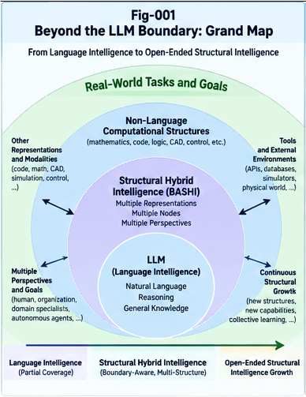

# Figure Index — Beyond the LLM Boundary

**Repository:** Beyond the LLM Boundary: Structural Hybrid Intelligence, Representation Barriers, and the Future of AI Architecture (BLB-SHI)  
**Version:** v1.0.0  
**Authors:** Sizhe Tan & GPT-Obot  
**Status:** Research illustrations; conceptual, not empirical results.

## Purpose

This index describes the seven planned figures supporting the eight-paper BLB-SHI series. The illustrations are conceptual architecture maps, not measurements or evidence that the proposed architecture outperforms existing systems.

> **Asset verification note:** The seven names below are the canonical target filenames. Before release, verify that **seven separate PNG files** exist under `figures/`, with content corresponding to each description. A single composite image containing seven panels is **not** equivalent to seven individually named assets. If the composite is used instead, update all links and captions consistently.

## Figure Catalog

| Figure | File | Focus | Primary paper(s) |
|---|---|---|---|
| Fig-001 | [Beyond-the-LLM-Boundary-Grand-Map](figures/Fig-001-Beyond-the-LLM-Boundary-Grand-Map.png) | Overall research thesis and eight-paper trajectory | BLB-001, BLB-008; README |
| Fig-002 | [Language-Coverage-vs-Structural-Sufficiency](figures/Fig-002-Language-Coverage-vs-Structural-Sufficiency.png) | Language accessibility versus representation, computational, and governance sufficiency | BLB-001 |
| Fig-003 | [Computational-Representation-Barriers](figures/Fig-003-Computational-Representation-Barriers.png) | Encoding, operational, and computational distinctions across representations | BLB-002 |
| Fig-004 | [Scaling-vs-Structural-Specialization](figures/Fig-004-Scaling-vs-Structural-Specialization.png) | Conditional economics of scaling, specialization, and hybrid systems | BLB-003 |
| Fig-005 | [Perspective-Sovereignty-and-Ownership-Partition](figures/Fig-005-Perspective-Sovereignty-and-Ownership-Partition.png) | Sovereign perspectives, ownership partitions, and authorized sharing | BLB-004 |
| Fig-006 | [Localization-Execution-Decoupling-and-CCC-Native-Intelligence](figures/Fig-006-Localization-Execution-Decoupling-and-CCC-Native-Intelligence.png) | Structural localization, per-node execution, and CCC-native integration | BLB-005, BLB-006 |
| Fig-007 | [BASHI-Architecture-and-Open-Ended-Structural-Growth](figures/Fig-007-BASHI-Architecture-and-Open-Ended-Structural-Growth.png) | BASHI control and execution planes; evidence-gated structural growth | BLB-007, BLB-008 |

## Captions and Placement Guidance

### Fig-001 — Beyond the LLM Boundary: Grand Map

**Canonical path:** `figures/Fig-001-Beyond-the-LLM-Boundary-Grand-Map.png`

**Caption:** *A conceptual map connecting the reach of language-based intelligence to computational representation barriers, economic specialization, perspective sovereignty, localization–execution decoupling, CCC-native semantic units, BASHI, and open-ended structural growth.*

**Recommended placement:** `README.md`, after the introductory thesis; optionally BLB-001 near the introduction or BLB-008 in its synthesis section. Avoid repeating the same image excessively.

### Fig-002 — Language Coverage vs. Structural Sufficiency

**Canonical path:** `figures/Fig-002-Language-Coverage-vs-Structural-Sufficiency.png`

**Caption:** *The distinction between tasks describable in natural language and tasks for which language-centered representations are operationally efficient, computationally competitive, and adequately governed. Conceptual relationships only; no empirical percentages are implied.*

**Recommended placement:** BLB-001, immediately following the discussion of descriptive, operational, and computational expressibility, or the four dimensions of sufficiency.

### Fig-003 — Computational Representation Barriers

**Canonical path:** `figures/Fig-003-Computational-Representation-Barriers.png`

**Caption:** *Computational representation barriers arise when translating between representations changes the cost, reliability, verifiability, or operational affordances of a task. A representation may encode another without matching its native execution properties.*

**Recommended placement:** BLB-002, following the formal representation-barrier framework (approximately after Section 5; confirm against the final manuscript).

### Fig-004 — Scaling vs. Structural Specialization

**Canonical path:** `figures/Fig-004-Scaling-vs-Structural-Specialization.png`

**Caption:** *A conditional economic comparison of general-model scaling, structural specialization, and hybrid orchestration, accounting for task distribution, integration overhead, verification, governance, and lifecycle maintenance. No universal crossover point is asserted.*

**Recommended placement:** BLB-003, following the specialization break-even analysis (approximately after Section 5; confirm against the final manuscript).

### Fig-005 — Perspective Sovereignty and Ownership Partition

**Canonical path:** `figures/Fig-005-Perspective-Sovereignty-and-Ownership-Partition.png`

**Caption:** *Shared intelligence capabilities can support multiple independently governed perspectives without requiring shared ownership of memory, goals, policies, or private context. Cross-boundary operations remain subject to explicit authority contracts.*

**Recommended placement:** BLB-004, following the Sovereign Brain Unit and ownership-partition architecture (approximately after Section 5.3; confirm against the final manuscript).

### Fig-006 — Localization–Execution Decoupling and CCC-Native Intelligence

**Canonical path:** `figures/Fig-006-Localization-Execution-Decoupling-and-CCC-Native-Intelligence.png`

**Caption:** *Structural localization identifies relevant context and candidate execution nodes; per-node intelligence selects appropriate computational representations and capabilities. CCC-native integration is proposed at progressively deeper levels, with verification and policy spanning the workflow.*

**Recommended placement:** BLB-005 after its architecture overview (approximately Section 4.7) and BLB-006 after its CCC-native integration discussion (approximately Section 7.1); verify section numbering in final files.

### Fig-007 — BASHI Architecture and Open-Ended Structural Growth

**Canonical path:** `figures/Fig-007-BASHI-Architecture-and-Open-Ended-Structural-Growth.png`

**Caption:** *The proposed BASHI architecture integrates task profiling, boundary diagnosis, structural localization, authorized hybrid execution, evidence and counter-evidence, policy control, and evidence-gated structural evolution with monitoring and rollback.*

**Recommended placement:** BLB-007 after the canonical architecture discussion (approximately Section 4.8) and BLB-008 near the growth lifecycle discussion (approximately Section 9.3); verify section numbering in final files.

## Markdown Embedding

For a document under `docs/`, the relative path to a figure is `../figures/`:

```markdown


*Figure 3. Computational representation barriers across encoding, operation, and execution.*
```

For a root-level document such as `README.md`, use `figures/`:

```markdown

```

## Figure-to-Paper Coverage

| Paper | Recommended figure(s) |
|---|---|
| BLB-001 — Language Intelligence and the Limits of Universal Coverage | Fig-001, Fig-002 |
| BLB-002 — Computational Representation Barriers Beyond Natural Language | Fig-003 |
| BLB-003 — The Economics of LLM Scaling and Structural Specialization | Fig-004 |
| BLB-004 — Perspective Sovereignty, Ownership, and the All-in-One Boundary | Fig-005 |
| BLB-005 — Decoupling Structural Localization from Per-Node Intelligence | Fig-006 |
| BLB-006 — CCC-Native Intelligence and Structural Semantic Units | Fig-006 |
| BLB-007 — BASHI: Boundary-Aware Structural Hybrid Intelligence Architecture | Fig-007 |
| BLB-008 — From LLM Boundaries to Open-Ended Structural Intelligence Growth | Fig-001, Fig-007 |

## Release Verification Checklist

- [ ] Seven individual PNG files exist at the canonical paths above.
- [ ] Each image depicts the topic stated by its filename and caption.
- [ ] All root-level Markdown links use `figures/`; all `docs/` links use `../figures/`.
- [ ] Figure numbers, captions, and filenames agree across README, CONTENTS, papers, and this index.
- [ ] Section placement references are checked against the final versions of BLB-001 through BLB-008.
- [ ] Text and arrows in the diagrams remain legible at GitHub's default display width.
- [ ] Conceptual illustrations are not described as validated experimental results.
- [ ] The license and attribution for generated illustrations are consistent with repository publication metadata.

## Citation and Research Integrity

These figures illustrate the conceptual research program authored by **Sizhe Tan & GPT-Obot**. They should not be interpreted as experimental validation, performance benchmarks, proofs of novelty, or claims that BASHI has already been implemented and evaluated. Hypotheses and comparative advantages require independent tests with appropriately strong baselines and counter-evidence.

---

**Navigation:** [README](README.md) · [START-HERE](START-HERE.md) · [CONTENTS](CONTENTS.md) · [GLOSSARY](GLOSSARY.md) · [FUTURE-DIRECTIONS](FUTURE-DIRECTIONS.md)

