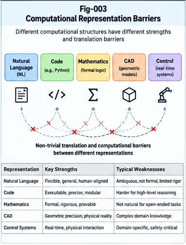

# BLB-002 — Computational Representation Barriers Beyond Natural Language

**Project:** Beyond the LLM Boundary: Structural Hybrid Intelligence, Representation Barriers, and the Future of AI Architecture (BLB-SHI)  
**Document ID:** BLB-002  
**Version:** 1.0.0  
**Status:** Conceptual Research, Formalization, and Testable Architecture Hypotheses  
**Authors:** Sizhe Tan & GPT-Obot  
**Date:** October 2026

---

## Abstract

The extraordinary breadth of large language models (LLMs) has sometimes encouraged an implicit architectural assumption: if an intelligent task can be expressed in language or tokens, a sufficiently capable language-centered model should be able to execute it effectively. This paper challenges the inference from *encodability* to *operational equivalence* and from operational equivalence to *computational competitiveness*.

We introduce the **Computational Representation Barrier (CRB)** as a task-relative, implementation-sensitive gap in the total resources, reliability, fidelity, or verification burden incurred when a task is executed through a non-native representation rather than a suitable native or specialized one. A CRB is not, by definition, a proof of mathematical impossibility. It is a measurable engineering and computational phenomenon whose existence and magnitude depend on task family, scale, interfaces, model capability, hardware, and permitted tools.

The paper distinguishes lossless encoding, semantic preservation, operational affordance, computational cost, and governance requirements. It develops a comparative cost model, a representation-translation graph, illustrative cases involving Calling Graphs, SQL, mathematical proof, geometry, and real-time control, and an experimental protocol for separating intrinsic representation effects from implementation quality. It also specifies counter-evidence and conditions under which language-centered or unified multimodal models may erase apparent barriers.

The resulting principle is not that natural language and specialized structures are mutually incomputable. It is that **representation choice is itself an intelligence-system design decision**. This motivates boundary-aware structural localization and hybrid execution in the BLB-SHI/BASHI research program.

**Keywords:** Computational Representation Barrier; LLM; Natural Language; Structural Intelligence; Calling Graph; SQL; Formal Verification; Hybrid AI; Representation Translation; Comparative Advantage; BASHI

---

---

## 1. Introduction: A Critical Inference to Reconsider

Transformer-based LLMs have demonstrated remarkable generalization across natural-language tasks, programming, structured data, mathematical reasoning, and tool use. Their achievements establish that token-based models can learn and manipulate an exceptionally broad range of representations. They do **not** establish that a language-centered execution path is the best implementation for every operation encoded in tokens.

A relational query can be written as text. A graph can be serialized into text. A mathematical proof can be rendered as a sequence of symbols. A robot trajectory can be described in natural language. Yet the ability to encode an object is different from the ability to operate on it accurately, efficiently, and with appropriate guarantees.

This distinction is central to BLB-002:

> **Encoding equivalence does not imply operational equivalence; operational feasibility does not imply computational or governance equivalence.**

BLB-001 established four separate assessment dimensions: intelligence coverage, representation sufficiency, computational optimality, and governance adequacy. This paper develops the second and third dimensions, while preserving the role of verification and policy in real deployments.

### 1.1 Research questions

1. Under what conditions does converting a task into natural-language or token-sequence form impose a measurable penalty?
2. How should such penalties be distinguished from deficiencies in a particular model, prompt, implementation, or hardware platform?
3. When is a specialized representation or execution engine advantageous, and when is a unified model preferable?
4. Can structural localization select execution pathways without incurring more overhead than it saves?
5. What observations would falsify the proposed barrier hypothesis for a given task family?

### 1.2 Scope

This is a conceptual and methodological paper. It proposes definitions, hypotheses, architecture interfaces, and experiments. It does not claim to have demonstrated new complexity-class separations, proved permanent limitations of Transformers, or measured universal superiority of Structural Intelligence (SI).

---

## 2. Why Specialized Representations Exist

Natural language is a flexible human communication medium, but technical systems often use purpose-built representations: relational schemas, graphs, tensor arrays, geometric models, formal logics, state machines, and executable programs.

These formats can offer:

- **Explicit invariants:** a graph has nodes and edges; a database has typed relations and constraints.
- **Direct operations:** traversal, joins, matrix multiplication, type checking, and proof checking.
- **Deterministic semantics:** specified operations have well-defined results under declared assumptions.
- **Efficient storage and access:** indexing, sparsity, locality, compression, and incremental updates.
- **Verifiability:** independently checkable outcomes, proofs, tests, and execution traces.
- **Domain-specific interfaces:** native tools expose operations that do not require repeated reconstruction from prose.

Their emergence suggests operational specialization, not an absolute inability of language to describe the same content. Indeed, SQL, programming languages, and mathematical notation are themselves symbolic languages. The relevant contrast is **unconstrained natural-language-centered execution versus task-appropriate formal or structured execution**, not an artificial binary of “language” and “non-language.”

### 2.1 A biological analogy—and its limit

The motivating discussion used *reproductive isolation* as an analogy: different forms of intelligence may be difficult to substitute for one another without losing their distinctive operational advantages. The analogy is useful as a heuristic for architectural non-substitutability, but it must not be interpreted literally.

Biological reproductive isolation concerns barriers to genetic exchange between populations. Computational representations are not biological species. They can often be translated, compiled, embedded, interpreted, or connected through APIs. Thus, the precise research claim is **costly or unreliable substitution under specified constraints**, not intrinsic or universal impossibility.

---

## 3. Five Distinct Levels of Representation Compatibility

A rigorous analysis should distinguish at least five levels.

### 3.1 Syntactic encodability

Can the source object be serialized in the target medium? A finite graph can generally be serialized as a list of vertices and edges. This is a weak condition: the serialized text may be extremely long or inconvenient.

### 3.2 Semantic preservation

Does the translation preserve the task-relevant meaning? A conversion can be syntactically valid but lose units, uncertainty, constraints, topology, or precision.

### 3.3 Operational affordance

Can the target system perform the required transformations directly and reliably? A text representation of a graph does not automatically provide an indexed adjacency structure or a graph traversal algorithm.

### 3.4 Computational competitiveness

How much time, compute, memory, energy, and engineering effort does the translated path require compared with a credible alternative at matched quality?

### 3.5 Verification and governance adequacy

Can the result be independently checked, and can the process comply with ownership, authorization, and safety requirements? A plausible generated proof is not a checked proof; a proposed SQL statement is not an authorized database transaction.

| Level | Core question | Typical failure |
|---|---|---|
| Encoding | Can it be serialized? | Excessive representation size |
| Semantics | Is relevant meaning preserved? | Lost units, constraints, or relations |
| Operations | Are needed operations available? | Reconstructing graph algorithms through prose |
| Efficiency | Is the pathway competitive? | Excess latency or compute at scale |
| Assurance | Can it be verified and authorized? | Unchecked results or unauthorized actions |

These levels are logically distinct. Success at one level should not be used as evidence for success at the next without measurement.

---

## 4. Defining the Computational Representation Barrier

### 4.1 Task-relative definition

Let a task instance be \(x\) from task family \(\mathcal{T}\), with requirements \(q\) covering quality, latency, reliability, and applicable policy. Let \(r\) denote a representation-and-execution pathway: an encoder, model or engine, any tools, verification, and output conversion.

Define a lifecycle-adjusted cost vector:

\[
\mathbf{C}(r,x,q) = (C_{\mathrm{compute}}, C_{\mathrm{latency}}, C_{\mathrm{memory}}, C_{\mathrm{energy}}, C_{\mathrm{integration}}, C_{\mathrm{verification}}).
\]

A pathway is **feasible** only if it meets the required quality and policy constraints. For a declared cost aggregation \(J\), compare a candidate pathway \(r_a\) with a reference pathway \(r_b\):

\[
\Delta_{\mathrm{CRB}}(x;q,r_a,r_b) = J(\mathbf{C}(r_a,x,q)) - J(\mathbf{C}(r_b,x,q)).
\]

A positive value indicates that \(r_a\) is more costly under the chosen metric and constraints. If one pathway fails the quality or authorization requirements, it should be recorded as **infeasible**, not assigned an arbitrary finite cost.

**Computational Representation Barrier (CRB):** a reproducible, materially significant performance, fidelity, reliability, or assurance disadvantage associated with a representation-and-execution pathway relative to an appropriate alternative for a specified task family and operating regime.

The word *associated* is deliberate: experiments must investigate whether the penalty arises from the representation itself, the solver, training, context length, data format, implementation, or system integration.

### 4.2 Scale-dependent barrier

For task size \(n\), define a comparative cost ratio for feasible systems:

\[
\rho(n)=\frac{J(\mathbf{C}(r_a,n))}{J(\mathbf{C}(r_b,n))}.
\]

If \(\rho(n)\) grows materially with \(n\), the evidence suggests a scale-sensitive comparative disadvantage in the evaluated regime. This is **not** automatically an asymptotic complexity lower bound; it may reflect constants, implementation choices, context limits, or hardware effects.

### 4.3 Quality-adjusted comparisons

A cheaper system that returns incorrect answers is not necessarily preferable. Comparisons should use matched success criteria, or report a Pareto frontier of quality versus cost. The reference pathway must include its own engineering, validation, maintenance, and orchestration expenses.

### 4.4 No universal scalar without explicit policy

Different stakeholders value latency, energy, correctness, privacy, and maintainability differently. The aggregation \(J\) therefore depends on a declared perspective and operational policy. BASHI should retain the underlying vector and feasibility constraints rather than concealing all tradeoffs inside one unexplained score.

---

## 5. A Representation-Translation Graph

We propose modeling available representations and execution environments as a directed graph:

\[
G_R=(V_R,E_R).
\]

Each node \(v\in V_R\) denotes a representation or execution environment, such as natural-language text, a typed graph, relational algebra, a theorem prover, a geometric model, or a numerical solver. Each directed edge \(e\in E_R\) denotes an available conversion, interpretation, compilation, API invocation, or verification step.

Each edge may have attributes:

- Conversion and interface cost.
- Semantic preservation conditions.
- Precision or uncertainty loss.
- Required permissions and trust boundaries.
- Validation obligations.
- Reversibility and audit requirements.

A task may be solved by multiple paths through this graph. The optimal path under one perspective may differ from the optimal path under another.

**Example:**

`User request → LLM interpretation → typed SQL query → database optimizer/executor → result validation → natural-language explanation`

This path preserves language as an interface while delegating execution to a specialized mechanism.

An alternative path that asks an LLM to simulate the entire database computation in tokens may be appropriate for tiny examples, but not necessarily for large datasets, transactions, or audited production workloads.

### 5.1 Structural localization as pathway selection

In SI terminology, localization identifies candidate task contexts and suitable execution nodes. The representation-translation graph supplies a possible substrate for such localization. The system should choose not just a model, but a **pathway with explicit conversion and verification contracts**.

---

## 6. Illustrative Task Families

The following examples are hypotheses about comparative advantage, not experimental findings of this paper.

### 6.1 Calling Graphs and dependency reasoning

A Calling Graph can be serialized into text. However, dependency reachability, cycle detection, topological ordering, and critical-path analysis are naturally supported by explicit graph structures and algorithms.

A language model may contribute by constructing, explaining, repairing, or interpreting the graph. A specialized graph engine may be preferable for large-scale exact traversal.

**Research question:** at what graph sizes and error tolerances does graph-native execution outperform token-centered execution after accounting for translation overhead?

### 6.2 SQL and relational execution

SQL is itself a formal language, making it an especially useful counterexample to a simplistic “language versus non-language” dichotomy. Its advantage arises from executable semantics and the database engine's indexing, optimization, transaction management, and access control.

A hybrid path can use an LLM to translate intent into a parameterized query, then use a database to enforce schema and permissions and execute the operation.

**Research question:** when does direct structured execution offer better end-to-end performance than a model-only approach, and how much of that benefit comes from indexing, optimization, or data locality?

### 6.3 Mathematics and formal proof

Mathematical reasoning may involve natural-language insight, symbolic manipulation, numerical approximation, and formal proof verification. These are related but not identical tasks.

A model may generate proof candidates; a theorem prover can check them against a formal system. The proof checker supplies a different assurance property from a fluent explanation.

**Research question:** what is the quality-cost frontier of model-only reasoning, model-plus-calculator, and model-plus-proof-checker workflows?

### 6.4 Engineering drawings and geometry

Natural-language descriptions of geometry may be ambiguous or cumbersome for exact dimensional operations. CAD models and geometric kernels expose constraints, tolerances, coordinate systems, and transformations directly.

A language model can interpret design requirements, but precise constraint solving may be better delegated to native geometry engines.

**Research question:** how do translation errors, dimensional fidelity, and revision cost compare across pathways?

### 6.5 Real-time control and embodied intelligence

A high-level instruction such as “avoid the obstacle and reach the target” is useful for goal specification. Millisecond-scale control loops require timely sensor integration, state estimation, and action selection under safety constraints.

This does not establish that Transformers cannot participate in control. It suggests that the required architecture must be evaluated against hard timing and assurance constraints, not only natural-language task success.

**Research question:** where should language planning end and specialized perception/control begin under specific latency and safety requirements?

---

## 7. Barrier Mechanisms: Where the Costs Can Arise

Potential mechanisms include:

**Serialization expansion.** A compact native structure may require a lengthy token sequence.

**Structural reconstruction.** Relations explicit in a graph or schema may need to be inferred or recreated before an operation.

**Precision mismatch.** Approximate prediction may be unsuitable where exact arithmetic or proof obligations are required.

**Sequential dependency.** Autoregressive output can impose latency when a task requires lengthy token-by-token generation; parallel or non-autoregressive pathways may reduce this cost.

**Context and retrieval overhead.** Repeatedly inserting large structures into context may be less efficient than maintaining indexed external state.

**Verification burden.** An uncertain answer may require independent checking, retries, or human supervision.

**Update locality.** A small change to a structured database or graph may be cheaper than updating a model's parameters, although retrieval and fine-tuning can mitigate this distinction.

**Policy mismatch.** A computationally effective path may be unavailable because it crosses a prohibited data or authority boundary.

These mechanisms may coexist. Experiments should isolate them where possible rather than attributing every observed difference to “language.”

---

## 8. Four Research Hypotheses

### H2.1 — Task-relative representation barriers exist

For at least some task families and operating regimes, one representation-and-execution pathway exhibits a significant quality-adjusted cost or reliability disadvantage relative to a specialized alternative.

**Potential falsifier:** matched evaluations repeatedly show no meaningful difference after correcting for implementation quality and orchestration overhead.

### H2.2 — Some barriers grow with task scale

For selected operations, representation conversion, context reconstruction, or generation overhead increases more rapidly with problem size than native structured execution over a practical range.

**Potential falsifier:** competitive implementations show stable or improving relative performance for language-centered execution across the tested scale range.

### H2.3 — Boundary-aware hybrid execution can improve outcomes

A system that selects task-appropriate representations and engines can outperform a fixed execution pathway on heterogeneous workloads, after including routing, integration, and verification costs.

**Potential falsifier:** routing errors and overhead eliminate the benefit or a well-designed conventional tool-using baseline matches performance.

### H2.4 — Barriers are dynamic, not immutable

Improved models, training, native multimodal representations, specialized attention, compilers, and tools can reduce or remove barriers previously observed.

**Potential falsifier:** this is primarily a caution against permanent claims; its empirical content should be studied by tracking comparative performance across system generations.

---

## 9. Experimental Design and Baselines

### 9.1 Minimum comparison set

- **A. Model-only:** a capable LLM without execution tools, under clearly specified context and prompting conditions.
- **B. Conventional tool-using LLM:** the same or comparable LLM with standard function calling and appropriate domain tools.
- **C. Native specialized execution:** an established task-specific engine with a conventional interface.
- **D. Boundary-aware structural hybrid:** a proposed BASHI-style pathway using explicit boundary assessment, localization, execution contracts, and verification.

A comparison limited to A versus D would be inadequate to establish the distinctive value of BASHI over existing tool orchestration.

### 9.2 Controls

Use equivalent task inputs, output requirements, hardware reporting, error thresholds, and access permissions. Report model versions, prompts, tool schemas, compiler/runtime versions, data distributions, and tuning effort. Include both in-distribution and shifted workloads.

### 9.3 Metrics

- Correctness and task completion rate.
- Latency distribution, including tail latency.
- Total inference and tool compute.
- Memory and token consumption.
- Energy when measurable.
- Conversion and integration overhead.
- Verification effort and undetected error rate.
- Security/authorization violations.
- Development and maintenance cost.

### 9.4 Scale curves and ablations

Vary problem size and structural complexity independently. Ablate structural localization, typed contracts, specialized execution, and independent verification to estimate their separate contributions.

### 9.5 Failure accounting

Distinguish: parsing errors, semantic conversion errors, wrong route selection, engine failures, hallucinated operations, timeout, policy denial, and verification failures. A failed path should not be hidden inside a mean score.

### 9.6 Statistical discipline

Predeclare primary metrics and decision thresholds. Use repeated trials, confidence intervals, and task-level stratification. Avoid selecting only examples where specialized execution is obviously superior. Publish negative results and counterexamples.

---

## 10. Implications for BASHI and Structural Intelligence

The CRB concept suggests a specific responsibility for the **Structural Localization Plane**: identify which representation and execution mechanism best satisfies a task's requirements.

A conceptual process is:

1. **Task interpretation:** derive goal, inputs, constraints, and required output.
2. **Representation analysis:** identify native structures and possible conversion losses.
3. **Boundary assessment:** estimate quality, cost, scale, assurance, and governance risks.
4. **Candidate localization:** find eligible Brain Units, tools, or composite pathways.
5. **Contract checking:** verify schema compatibility, authority, and expected evidence.
6. **Execution:** perform work through the selected pathway or parallel alternatives.
7. **Independent verification:** check results using task-appropriate methods.
8. **Structural feedback:** record failures, counter-evidence, and reusable improvements.

This is a proposed reference workflow, not an implemented algorithm in this release.

### 10.1 The role of CCC, MDT, UTN, and PIRP/PIRU

- **CCC:** candidate structural semantic units carrying context, constraints, and evidence.
- **MDT:** candidate differential structures for task localization and narrowing.
- **UTN/CBT:** candidate context-bound identity and retrieval mechanisms.
- **PIRP/PIRU:** candidate portable descriptions or executable units for specialized capabilities.
- **Two-Way CCC:** a proposed interface for validation and counter-evidence exchange.
- **Policy Control Plane:** authorization and ownership constraints applied before and during execution.

These mechanisms should be compared against established alternatives. Their names alone do not establish technical novelty or empirical benefit.

### 10.2 Structural specialization is not an anti-LLM thesis

An LLM may be the best controller for some pathways and a specialist component in others. A future Transformer might natively implement many operations now delegated externally. BASHI should remain **model-agnostic and boundary-aware**, not dependent on the permanent weakness of any one architecture.

---

## 11. Related Work and Differentiation

Several established research lines already demonstrate that AI systems can combine learned models with specialized operations:

- **Transformers:** general-purpose attention-based sequence modeling [1].
- **Mixture-of-Experts:** conditional computation and specialized expert selection [2].
- **Retrieval-Augmented Generation:** external information access [3].
- **Toolformer and ReAct:** learned or prompted interaction with tools and environments [4, 5].
- **Formal methods and database systems:** precise execution and independent verification under explicit semantics [6, 7].

BLB-SHI does not claim to invent modular computation, tool use, routing, formal verification, or hybrid AI. Its proposed research contribution is to **jointly model representation choice, translation cost, structural localization, verification obligations, perspective, ownership, and governance as first-class routing constraints**.

Whether this integrated framework provides practical improvements over existing systems is an empirical question, to be addressed in later work.

---

## 12. Limitations and Counterarguments

### 12.1 Language can encode formal structures

A sufficiently precise symbolic language can encode graphs, programs, and proofs. Therefore, any claim that these are inherently inexpressible in language is too strong. The relevant issue is operational and computational suitability.

### 12.2 Models can internalize specialized algorithms

Transformer-based models may learn algorithmic procedures, use structured internal representations, or interact with external executors. The location of a barrier can move as model and system design improves.

### 12.3 Specialized systems incur integration costs

A hybrid design may suffer from brittle interfaces, maintenance burdens, routing errors, and fragmented context. These costs can outweigh the gains of specialization.

### 12.4 No clean separation of language and non-language intelligence

Many technical notations are languages; multimodal models also process images, audio, and spatial data. This paper uses *natural-language-centered* to denote an execution strategy, not a rigid taxonomy of intelligence.

### 12.5 Comparisons are hardware- and implementation-sensitive

Measured differences do not establish a universal complexity theorem. A better implementation, accelerator, or model generation can reverse a result.

### 12.6 Governance is not solved by representation alone

Typed structures, local execution, or modular architecture do not automatically ensure privacy, authorization, or accountability. These require explicit mechanisms, tests, and institutional controls.

---

## 13. Future Research Directions

1. **Representation Barrier Benchmarks:** build matched graph, SQL, formal proof, geometry, and control task suites.
2. **Translation Cost Models:** estimate fidelity loss, token expansion, verification expense, and interface overhead.
3. **Barrier-Aware Routing:** test whether learned or structural routing improves over standard tool selection.
4. **CCC-Native Interfaces:** explore structured semantic units that reduce repeated textual reconstruction.
5. **Perspective-Conditioned Pathways:** test how user-specific cost, privacy, and authority constraints change optimal routing.
6. **Structural Delta Growth:** study whether repeated failures can produce reusable localized improvements.
7. **Dynamic Barrier Tracking:** repeat evaluations as foundation models and specialist engines evolve.
8. **Negative-Result Registry:** maintain explicit cases where hybridization adds complexity without benefit.

The research program should prioritize small, controlled experiments before making broad architectural superiority claims.

---

## 14. Conclusion

The existence of a textual encoding for an intelligent task does not establish that text-centered computation is the most effective way to execute it. Likewise, the extraordinary breadth of LLM capabilities does not eliminate the comparative advantages of graphs, databases, formal systems, geometry engines, numerical solvers, and specialized control systems.

This paper defines the **Computational Representation Barrier** as a task-relative and empirically measurable disadvantage associated with a representation-and-execution pathway. It distinguishes encodability, semantic fidelity, operational affordance, computational competitiveness, and verification/governance adequacy.

The core conclusion is deliberately conditional:

> **Different representations can be computationally interchangeable in principle while remaining substantially unequal in cost, reliability, and governability in practice.**

The appropriate response is not to abandon general-purpose LLMs, but to develop systems capable of recognizing representation requirements and coordinating suitable mechanisms. That is the motivation for boundary-aware structural hybrid intelligence.

**The goal is not to erase every intelligence boundary inside one model; it is to cross boundaries deliberately, efficiently, and with verifiable control.**

---

## 15. Relationship to the BLB-SHI Series

- **BLB-001 — Language Intelligence and the Limits of Universal Coverage:** establishes the coverage/sufficiency distinction and six-dimensional boundary framework.
- **BLB-003 — The Economics of LLM Scaling and Structural Specialization:** examines the marginal cost and lifecycle economics of different growth pathways.
- **BLB-004 — Perspective Sovereignty, Ownership, and the All-in-One Boundary:** addresses stakeholder goals, private context, and authority.
- **BLB-005 — Decoupling Structural Localization from Per-Node Intelligence:** develops the routing/execution separation.
- **BLB-006 — CCC-Native Intelligence and Structural Semantic Units:** studies structural semantic representations and model interfaces.
- **BLB-007 — BASHI: A Boundary-Aware Structural Hybrid Intelligence Architecture:** integrates boundary profiling, pathway selection, contracts, verification, and governance.
- **BLB-008 — From LLM Boundaries to Open-Ended Structural Intelligence Growth:** proposes validation, counter-evidence, and evolution pathways.

**Suggested figure:** `../figures/Fig-003-Computational-Representation-Barriers.png`, placed after Section 5, illustrating a representation-translation graph and the distinction between encoding, operation, and verification.

---

## References and Foundational Reading

1. Vaswani, A., et al. (2017). *Attention Is All You Need.* NeurIPS. https://arxiv.org/abs/1706.03762
2. Fedus, W., Zoph, B., & Shazeer, N. (2022). *Switch Transformers: Scaling to Trillion Parameter Models with Simple and Efficient Sparsity.* JMLR, 23(120), 1–39. https://arxiv.org/abs/2101.03961
3. Lewis, P., et al. (2020). *Retrieval-Augmented Generation for Knowledge-Intensive NLP Tasks.* NeurIPS. https://arxiv.org/abs/2005.11401
4. Schick, T., et al. (2023). *Toolformer: Language Models Can Teach Themselves to Use Tools.* NeurIPS. https://arxiv.org/abs/2302.04761
5. Yao, S., et al. (2023). *ReAct: Synergizing Reasoning and Acting in Language Models.* ICLR. https://arxiv.org/abs/2210.03629
6. Codd, E. F. (1970). *A Relational Model of Data for Large Shared Data Banks.* Communications of the ACM, 13(6), 377–387. https://doi.org/10.1145/362384.362685
7. Nipkow, T., Wenzel, M., & Paulson, L. C. (2002). *Isabelle/HOL: A Proof Assistant for Higher-Order Logic.* Springer. https://doi.org/10.1007/3-540-45949-9
8. Tan, S., & GPT-Obot. *Metric Differential Tree, UTN, and Context-Bound Token Intelligence.* https://github.com/sizhet/Metric-Differential-Tree-UTN-and-Context-Bound-Token-Intelligence
9. Tan, S., & GPT-Obot. *Portable Intelligence Runtime Pieces and Units.* https://github.com/sizhet/Portable-Intelligence-Runtime-Pieces-and-Units
10. Tan, S., & GPT-Obot. *Structural Recursive Self-Improvement.* https://github.com/sizhet/Structural-Recursive-Self-Improvement

The references provide background and adjacent methods. The CRB definition, proposed evaluation program, and BASHI integration are conceptual contributions requiring independent empirical validation.

---

## Citation

Suggested citation before DOI assignment:

Tan, S., & GPT-Obot. (2026). *Computational Representation Barriers Beyond Natural Language.* BLB-002, Version 1.0.0. In *Beyond the LLM Boundary: Structural Hybrid Intelligence, Representation Barriers, and the Future of AI Architecture.*

**Repository:** `Beyond-the-LLM-Boundary-Structural-Hybrid-Intelligence`  
**License:** Apache-2.0, subject to repository licensing and attribution arrangements.  
**Research status:** Conceptual framework and proposed evaluation methodology; empirical validation pending.

---

*End of BLB-002 — Computational Representation Barriers Beyond Natural Language.*
