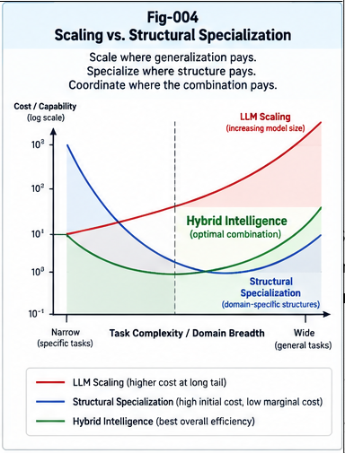

# BLB-003 — The Economics of LLM Scaling and Structural Specialization

**Project:** Beyond the LLM Boundary: Structural Hybrid Intelligence, Representation Barriers, and the Future of AI Architecture (BLB-SHI)  
**Document ID:** BLB-003  
**Version:** 1.0.0  
**Status:** Conceptual research, economic framework, and empirical research agenda  
**Authors:** Sizhe Tan & GPT-Obot  
**Date:** October 2026

---

## Abstract

Transformer-based large language models (LLMs) have delivered unusually broad capabilities through scaling of data, parameters, and computation. Their success raises an economic question that cannot be settled by capability benchmarks alone: for a given increment in useful intelligence, when is it more efficient to scale a general-purpose model, and when is it more efficient to introduce specialized representations, algorithms, models, memory, or structural coordination? This paper proposes a task- and lifecycle-aware framework for comparing **LLM scaling**, **structural specialization**, and **hybrid growth**. It distinguishes average from marginal cost, training from inference, model capability from system-level value, and benchmark gains from deployable reliability. It introduces a constrained optimization model for selecting intelligence architectures, a representation-barrier-adjusted view of the long tail, and an economic account of localization, reuse, governance, and structural delta growth. The paper neither predicts an inevitable end to scaling nor assumes that modular architectures are intrinsically cheaper. Instead, it develops falsifiable conditions under which each approach can dominate and a research program for measuring the crossover. The framework provides an economic foundation for Boundary-Aware Structural Hybrid Intelligence (BASHI).

**Keywords:** LLM scaling; structural specialization; marginal intelligence economics; hybrid AI; lifecycle cost; inference economics; representation barriers; localization; Brain Units; BASHI; governance.

---

---

## 1. Introduction: The Next Unit of Useful Intelligence

The historical achievement of large language models is not in question. General-purpose foundation models have converted immense training investments into reusable capabilities across language, software, knowledge work, and increasingly multimodal tasks. They have reduced the cost of accessing many forms of computation through a common interface.

Yet **the economic attractiveness of broad capability does not imply that every additional capability should be obtained by scaling the same model**. A system designer must decide how to deliver a specified level of task quality, reliability, latency, security, and control at an acceptable total cost. The choice is not simply “large model versus small model.” It may involve additional pretraining, fine-tuning, retrieval, deterministic algorithms, specialized models, graph operations, structured memory, or combinations of these.

This paper asks:

> For a specified task distribution and operational constraints, what is the least costly way to obtain the next unit of *verified, deployable intelligence*?

The answer depends on workload volume, task heterogeneity, quality thresholds, integration cost, model prices, hardware, governance, and the availability of reusable structures. No single approach should be assumed superior across all settings.

### 1.1 Relation to BLB-001 and BLB-002

BLB-001 distinguishes intelligence coverage from representation sufficiency, computational optimality, and governance adequacy. BLB-002 studies computational representation barriers: the possible overhead of performing operations through representations less suited to their native structure.

BLB-003 adds a third question: **when do those differences become economically decisive?** A representation barrier may exist without being economically relevant at small scale. Conversely, a modest efficiency advantage can become decisive under high-volume, latency-sensitive, or high-assurance workloads.

### 1.2 Central thesis

> Scaling and structural specialization are complementary growth mechanisms whose relative value depends on marginal task quality, workload composition, lifecycle cost, and governance constraints. The economically preferred architecture may change as models, tasks, and prices evolve.

This is a conditional research thesis, not a claim that scaling has reached a fixed ceiling.

---

## 2. Three Distinct Growth Routes

### 2.1 Route A: General-purpose model scaling

Model scaling includes increasing training computation, data, parameter capacity, or test-time reasoning computation. It can improve multiple capabilities simultaneously, sometimes yielding benefits in tasks that were not individually targeted.

**Strengths:** broad transfer; common interface; shared infrastructure; low per-task engineering effort when the model already works; flexibility under changing tasks.

**Costs and risks:** large capital commitments; inference and context costs; uncertain incremental gains on specific tails; model-refresh and evaluation costs; constraints in explainability, determinism, or local ownership for some deployments.

Scaling is not a single variable. Pretraining scale, post-training, retrieval, context length, and test-time compute have different cost curves and should not be conflated.

### 2.2 Route B: Structural specialization

Structural specialization introduces task-specific or domain-specific representations and execution mechanisms, such as SQL engines, graph algorithms, formal solvers, local memory, narrow models, or dedicated Brain Units.

**Strengths:** potential efficiency on repeated operations; explicit structure; domain-specific validation; predictable behavior; localized maintenance and governance.

**Costs and risks:** design and integration effort; brittle task boundaries; routing failures; operational fragmentation; specialized assets becoming obsolete; weaker transfer to novel tasks.

Specialization is justified only if its benefits exceed these costs over the expected deployment horizon.

### 2.3 Route C: Structural hybrid growth

A hybrid system combines a general-purpose model with explicit localization, specialized execution, and evidence-based verification. The model may interpret requests and coordinate work; a database, solver, graph engine, or other Brain Unit performs operations for which it has comparative advantage.

Hybrid growth is not necessarily novel merely because it uses tools or experts. The BLB-SHI proposal focuses on a broader coordination problem: **representation-aware routing across independent computational mechanisms, perspectives, ownership domains, and policy constraints**, with recorded evidence and reusable structural deltas.

A hybrid architecture can inherit both sets of advantages—and both sets of costs.

---

## 3. Define the Economic Unit Correctly

### 3.1 Why tokens and benchmark points are insufficient

Cost per token is useful for pricing but does not measure the cost of a correct, authorized, verifiable outcome. Benchmark accuracy is useful but may omit latency, human review, failures, tool costs, and downstream harm.

We define a **qualified task completion** as an outcome that meets specified acceptance criteria for correctness, latency, safety, privacy, and authorization. These criteria must be fixed before comparing systems.

For task family \(i\), let:

- \(q_i(a)\): probability that architecture \(a\) meets its task acceptance criteria;
- \(v_i\): value of a qualified completion;
- \(n_i\): expected task volume over the evaluation horizon;
- \(c_i(a)\): variable execution and verification cost per attempt;
- \(F(a)\): fixed development, training, integration, and deployment cost;
- \(M(a)\): lifecycle maintenance, monitoring, security, and migration cost.

An illustrative expected net value is

\[
NV(a)=\sum_i n_i\bigl[v_i q_i(a)-c_i(a)\bigr]-F(a)-M(a).
\]

This simplified expression assumes failures are captured adequately by the quality term. High-stakes applications should explicitly add expected loss from errors, including tail risks, rather than compressing all consequences into \(q_i\).

### 3.2 Lifecycle cost

The relevant cost is **total cost of ownership**, not only inference cost:

\[
TCO(a)=C_{train}+C_{adapt}+C_{integrate}+C_{infer}+C_{verify}+C_{operate}+C_{govern}+C_{migrate}.
\]

Not every term applies to every architecture. For a third-party API, training cost may be embedded in pricing; for a self-hosted model, hardware depreciation and engineering time become explicit. Comparisons must avoid double-counting.

### 3.3 Marginal intelligence efficiency

For a change from architecture \(a_0\) to \(a_1\), define a workload-specific measure:

\[
MIE(a_0\!\to\!a_1)=\frac{\Delta U}{\Delta TCO},\qquad \Delta TCO>0,
\]

where \(\Delta U\) is the change in *qualified task utility* over the same workload and time horizon. If costs fall while utility is maintained, compare cost savings directly rather than forcing the ratio to describe that case.

This measure is not universal: its meaning depends on the task mix, utility weights, and acceptance criteria. It should be reported alongside the underlying quality and cost components.

---

## 4. The Long Tail Is Not One Economic Phenomenon

“Long-tail intelligence” is often treated as a single problem: rare tasks requiring additional general model capability. In practice, at least four different tails should be distinguished.

| Tail type | Typical feature | Plausible response |
|---|---|---|
| Knowledge tail | Rare facts or frequently changing information | Retrieval, curated data, model adaptation |
| Operation tail | Rare but structurally precise computations | Solver, SQL, graph or domain engine |
| Perspective tail | Distinct stakeholder goals and constraints | Perspective-aware Brain Units and policies |
| Assurance tail | High cost of an incorrect or unauthorized result | Verification, audit, human approval, formal methods |

A rare question that requires retrieval is not economically equivalent to a rare action that requires strict authorization. Likewise, a rare graph computation may be cheap with a deterministic engine but expensive if approximated through repeated text reasoning.

### 4.1 Tail frequency and reuse

A specialist may have high fixed cost and low variable cost. If the task occurs only once, the fixed cost may not be justified. If it occurs millions of times, even a small per-task saving can dominate.

Let \(F_s\) be incremental fixed cost of specialization, and let \(\Delta c\) be per-task cost saving at matched acceptance quality. A simplified break-even volume is:

\[
N^*=\frac{F_s}{\Delta c},\qquad \Delta c>0.
\]

**Illustrative example, not empirical evidence:** If specialization costs $40,000 to implement and saves $0.20 per qualified task, break-even occurs at 200,000 tasks, excluding discounting, maintenance changes, and risk differences.

This simple result highlights why the same architecture can be rational for one organization and irrational for another.

### 4.2 The representation-barrier multiplier

Following BLB-002, let \(b_i(a)\) denote the measured overhead attributable to representation translation or mismatch on task family \(i\). It may include additional latency, tokens, conversions, validation effort, or failure recovery.

A task's effective execution cost can be decomposed as:

\[
c_i(a)=c_{native,i}(a)+c_{translation,i}(a)+c_{coordination,i}(a)+c_{verification,i}(a).
\]

This is an accounting decomposition, not a proof that every term can be isolated uniquely. In practice, researchers should specify measurement methods and avoid attributing all LLM overhead to representation mismatch.

### 4.3 When scaling wins the tail

Scaling may be preferable when a capability improvement transfers broadly across many tasks, task boundaries are unstable, integration cost is high, or specialized execution adds little value. A general-purpose model can also reduce the cost of developing and operating specialists.

Thus the long tail does not establish a universal argument against scaling. It creates a **portfolio allocation problem**.

---

## 5. Architecture Choice as Constrained Optimization

Let \(\mathcal{A}\) denote candidate architectures, including scaled general-purpose models, specialist systems, and hybrid configurations. Let \(D\) denote the deployment workload distribution.

A system designer may solve:

\[
a^*=\arg\min_{a\in\mathcal{A}} TCO(a;D)
\]

subject to:

\[
Q_i(a)\geq q_i^{min},\quad L_i(a)\leq \ell_i^{max},\quad
R_i(a)\leq r_i^{max},\quad a\in\mathcal{A}_{authorized}.
\]

Here \(Q_i\) is qualified task performance, \(L_i\) latency, \(R_i\) defined risk, and \(\mathcal{A}_{authorized}\) the set of architectures permitted by ownership and policy constraints.

**Governance is not merely a price penalty.** An unauthorized architecture must be excluded even when it appears inexpensive or capable.

### 5.1 Boundary-aware routing

At runtime, a router may choose a candidate execution plan \(r\) based on task structure, model capabilities, quality forecasts, and policy constraints:

\[
r^*=\arg\max_{r\in\mathcal{R}_{allowed}(T)}
\bigl[\widehat{Q}(r,T)-\lambda\widehat{C}(r,T)-\mu\widehat{R}(r,T)-\nu\widehat{V}(r,T)\bigr].
\]

The estimated quantities require calibration and monitoring. The weights reflect a specific operating context, not universal constants. Hard constraints should remain hard constraints.

### 5.2 The localization tax

Structural localization is not free. It introduces:

- candidate retrieval and routing latency;
- index and structural-memory maintenance;
- errors from choosing the wrong specialist;
- context packaging and translation;
- fallback and escalation paths;
- monitoring and governance checks.

Call these costs the **localization tax**. BASHI provides economic value only when avoided execution costs, improved quality, or reduced risks exceed this tax.

This creates a useful design objective: *minimize the cost of finding and invoking the right intelligence without sacrificing correct selection*.

---

## 6. Structural Reuse and the Economics of Learning

### 6.1 Parameter updates versus structural updates

A new task requirement can sometimes be handled by updating a general model, but it can also be handled by adding a local rule, graph node, verified procedure, retrieval record, CCC, or PIRU. These update paths have different costs and different effects on previously learned behavior.

A local structural update may be attractive when the change is narrow, needs explicit versioning, or is owned by one domain. A model update may be attractive when the change should generalize broadly or when explicit structures would be brittle.

### 6.2 Structural delta as an economic asset

A reusable structural delta can be understood as a versioned improvement that reduces future task cost or failure risk. Its value depends on:

- frequency of reuse;
- quality and reliability of the delta;
- portability across contexts;
- verification cost;
- compatibility and maintenance burden;
- governance and ownership permissions.

A structure with high creation cost and negligible reuse may have negative net value. A modest verified delta reused across many Brain Units may have substantial value.

### 6.3 Collective learning without uncontrolled sharing

Shared structural patterns need not require sharing raw private context. A portable artifact may expose a contract, interface, or generalized procedure while keeping sensitive data local.

This is a promising direction for PIRP/PIRU and sovereign Brain Units, but the economic benefit depends on actual transferability and on the costs of privacy-preserving adaptation and conformance testing.

---

## 7. Perspective, Ownership, and Governance Are Economic Variables

### 7.1 Perspective diversity

A general model can simulate multiple stakeholder perspectives. Yet an organization may need separate objectives, evidence, approval chains, and responsibility boundaries. These requirements can make a single shared execution context operationally inappropriate even when the model is technically capable.

The economic question is not whether one model can *describe* multiple perspectives, but whether it can support the required **independent decision rights** at acceptable cost and risk.

### 7.2 Ownership and concentration

Centralized systems may benefit from economies of scale, centralized security operations, and rapid updates. Distributed or sovereign systems may improve control, residency, and organizational autonomy, but introduce duplication and maintenance burdens.

Concentration also creates potential dependency, outage, switching, and bargaining risks. These should be assessed using concrete deployment assumptions, not treated as inevitable failures of all centralized services.

### 7.3 Governance-adjusted value

For high-stakes workloads, the expected cost of mistakes, unauthorized actions, or inadequate audit trails may exceed inference cost. Architecture comparisons should include explicit assurance requirements and plausible failure-loss scenarios.

A cheap response that cannot be lawfully or safely acted upon is not a cheap qualified completion.

---

## 8. The BASHI Economic Decision Procedure

The following is a **conceptual skeleton**, not an implemented or validated algorithm.

**Input:** task distribution, acceptance criteria, candidate engines, ownership rules, latency constraints, expected volumes, and lifecycle horizon.

**Step 1 — Characterize the workload.** Partition tasks by representation, frequency, quality threshold, variability, and risk.

**Step 2 — Establish strong baselines.** Measure a general-purpose LLM and an LLM equipped with conventional retrieval and tools. Avoid comparing a mature hybrid system only to a deliberately tool-free baseline.

**Step 3 — Profile structural barriers.** Identify costly representation translations, verification bottlenecks, and opportunities for native computation.

**Step 4 — Generate candidates.** Include scaled-model, specialist, and hybrid alternatives; estimate fixed, variable, and maintenance costs.

**Step 5 — Apply policy constraints.** Exclude candidates that violate ownership, authorization, or assurance requirements.

**Step 6 — Evaluate quality-adjusted lifecycle value.** Compare qualified completions, failure costs, latency, and TCO under matched workloads.

**Step 7 — Deploy with evidence.** Log routing decisions, performance, counter-evidence, and realized cost.

**Step 8 — Grow selectively.** Introduce or retire Brain Units, CCC structures, and routing branches when measured benefits justify their costs.

**Step 9 — Re-evaluate.** Recompute the preferred architecture as model capabilities, API prices, workload volumes, and policy requirements change.

The final step is essential: structural specialization should not become permanent technical debt simply because it was once efficient.

---

## 9. Falsifiable Research Hypotheses

**H1 — Workload-dependent crossover.** For some repeated, structurally precise tasks, specialist or hybrid execution reaches lower cost per qualified completion than general-model-only execution after a measurable workload threshold.

**H2 — Representation-barrier correlation.** Measured representation-translation overhead predicts some of the efficiency advantage of native execution, after controlling for task difficulty and implementation quality.

**H3 — Structural localization advantage.** On heterogeneous workloads, explicit boundary-aware localization can improve quality-adjusted cost relative to a strong conventional tool-calling baseline, when routing accuracy is sufficiently high.

**H4 — Structural reuse advantage.** Verified, reusable structural deltas can reduce adaptation cost for recurring local changes relative to repeated model adaptation in selected domains.

**H5 — Governance-conditioned preference.** Ownership and authorization requirements change the feasible architecture set and can reverse a choice based solely on inference cost.

**H6 — Dynamic optimality.** The preferred architecture changes over time as general-model capabilities, prices, specialist maintenance costs, and workload composition change.

Each hypothesis admits counterexamples. None is presented as an empirical result.

---

## 10. Experimental Program

### 10.1 Baselines

Compare at least:

- **A:** general-purpose LLM, no external execution tools;
- **B:** LLM with standard retrieval, function calling, and available tools;
- **C:** task-specialized native execution with a minimal interface;
- **D:** BASHI-style structural localization and hybrid execution.

Where relevant, include a stronger model and a smaller fine-tuned model. Use the same task inputs, quality thresholds, hardware/accounting conventions, and policy requirements.

### 10.2 Task families

1. SQL query generation and execution over controlled databases.
2. Calling Graph reachability, dependency analysis, and path computation.
3. Formal or mathematical verification with explicit checkers.
4. Repetitive document workflows with changing local policies.
5. Multi-perspective decisions requiring independent constraints.
6. Private-context tasks with explicit data residency and authority rules.

### 10.3 Measures

Report: qualified success rate; cost per qualified completion; p50/p95 latency; energy or compute proxy; human review time; failure recovery; routing accuracy; integration effort; maintenance; authorization violations; and sensitivity to workload scale.

Use confidence intervals where feasible. Publish task definitions, prompts, tool contracts, model versions, pricing assumptions, and evaluation scripts. For rare severe failures, avoid claiming safety from small samples.

### 10.4 Ablations

Remove structural localization, native execution, explicit verification, and reusable structural memory separately to estimate each component's contribution. Include an oracle router as an upper-bound diagnostic, not as a deployable baseline.

### 10.5 Counter-evidence

Actively seek cases where:

- a stronger general model eliminates the specialist advantage;
- task volumes are too small to amortize specialization;
- routing mistakes erase savings;
- integration and maintenance exceed inference savings;
- structural representations become stale or brittle;
- policy checks add latency without measurable assurance benefit;
- general-model transfer outperforms narrow local updates.

The research program succeeds by locating the crossover conditions, not by guaranteeing a BASHI victory.

---

## 11. Capital Allocation and Market Narratives

The economics of scaling has consequences beyond individual deployments. Large investments in compute infrastructure and model development depend on expectations about future demand, capability improvements, utilization, pricing, and competitive differentiation.

If projected returns assume that additional scaling will economically solve all long-tail tasks, representation and governance costs may be underestimated. Conversely, underestimating broad model improvements may lead organizations to overinvest in brittle specialist infrastructure.

Neither observation establishes that an AI investment bubble exists or that a financial crisis will occur. Market outcomes depend on financing conditions, revenue realization, competition, and macroeconomic factors outside the scope of this paper.

The defensible recommendation is **scenario-based capital allocation**: stress-test investments against slower capability gains, faster model commoditization, shifting inference prices, and the possibility that some tasks are more efficiently handled by specialized systems.

---

## 12. Relationship to Structural Intelligence and Future AI Architecture

This economic framework supports several broader SI research directions:

- **MDT / UTN / CCC:** reducing the cost of locating task-relevant context and reusable structures;
- **Calling Graphs:** making dependencies and execution structure explicit;
- **PIRP / PIRU:** packaging reusable, versioned intelligence components;
- **Sovereign Brain Units:** allowing local control while selectively sharing capability;
- **Two-Way CCC and Counter-Evidence:** testing whether outputs and structural updates remain consistent;
- **Policy Control Plane:** constraining feasible actions and ownership boundaries;
- **Structural RSI:** evaluating whether localized self-improvement produces measurable net benefit.

These are proposed architectural connections, not demonstrations of performance.

The next paper, BLB-004, examines the perspective and ownership dimensions that conventional compute-only economic comparisons often omit.

---

## 13. Limitations and Open Questions

This paper is conceptual. It supplies neither measured crossover points nor evidence that BASHI has lower cost in any specific production environment. The accounting model simplifies uncertain demand, correlated failures, nonlinear scaling effects, and the option value of general-purpose capability.

Open questions include:

1. What is the most defensible unit of deployable intelligence value across heterogeneous tasks?
2. How should common model-training costs be allocated across downstream uses?
3. Which representation barriers predict measurable cost differences?
4. How rapidly do specialist advantages disappear as models improve?
5. Can structural localization achieve enough accuracy to justify its overhead?
6. How should uncertainty in future prices, regulation, and demand affect architecture choice?
7. How can collective structural learning preserve ownership without excessive duplication?
8. What evidence is sufficient to authorize an automated structural update?

---

## 14. Conclusion

LLM scaling has created a remarkably general computational foundation. Structural specialization offers a different growth mechanism: investing in representations, algorithms, tools, and local intelligence units tailored to particular operations and constraints.

The relevant question is not which approach is ideologically preferable. It is which combination delivers **qualified, verifiable, authorized outcomes** at the lowest lifecycle cost for a defined workload.

Three principles follow:

1. **Broad model capability is not proof of universal marginal economic efficiency.**
2. **Specialization is not free; routing, integration, verification, and maintenance must be counted.**
3. **The preferred architecture is conditional and dynamic, not a permanent winner.**

This is the economic foundation for Boundary-Aware Structural Hybrid Intelligence: preserve the generalist's breadth, exploit specialists where their comparative advantage is measurable, and govern the composition as a system.

> Scale where generalization pays. Specialize where structure pays. Coordinate where the combination pays.

---

## 15. Figure Placement

**Planned figure:** `figures/Fig-004-Scaling-vs-Structural-Specialization.png`

**Recommended placement:** immediately after Section 5, *Architecture Choice as Constrained Optimization*, before Section 6.

**Suggested caption:** *The economics of intelligence growth: general-model scaling, structural specialization, and hybrid architectures exhibit different fixed costs, variable costs, quality thresholds, and crossover conditions. Curves are conceptual; no empirical crossover is asserted.*

Do not label illustrative curves as measured results.

---

## References and Foundational Reading

1. Vaswani, A., et al. (2017). *Attention Is All You Need.* https://arxiv.org/abs/1706.03762
2. Kaplan, J., et al. (2020). *Scaling Laws for Neural Language Models.* https://arxiv.org/abs/2001.08361
3. Hoffmann, J., et al. (2022). *Training Compute-Optimal Large Language Models.* https://arxiv.org/abs/2203.15556
4. Fedus, W., Zoph, B., & Shazeer, N. (2022). *Switch Transformers: Scaling to Trillion Parameter Models with Simple and Efficient Sparsity.* https://arxiv.org/abs/2101.03961
5. Lewis, P., et al. (2020). *Retrieval-Augmented Generation for Knowledge-Intensive NLP Tasks.* https://arxiv.org/abs/2005.11401
6. Schick, T., et al. (2023). *Toolformer: Language Models Can Teach Themselves to Use Tools.* https://arxiv.org/abs/2302.04761
7. Yao, S., et al. (2023). *ReAct: Synergizing Reasoning and Acting in Language Models.* https://arxiv.org/abs/2210.03629
8. Tan, S., & GPT-Obot. *Metric Differential Tree, UTN, and Context-Bound Token Intelligence.* https://github.com/sizhet/Metric-Differential-Tree-UTN-and-Context-Bound-Token-Intelligence
9. Tan, S., & GPT-Obot. *Portable Intelligence Runtime Pieces and Units.* https://github.com/sizhet/Portable-Intelligence-Runtime-Pieces-and-Units
10. Tan, S., & GPT-Obot. *Structural Recursive Self-Improvement.* https://github.com/sizhet/Structural-Recursive-Self-Improvement

These references provide background and architectural context; they do not establish the BLB-SHI hypotheses.

---

## Citation

Tan, S., & GPT-Obot. (2026). *The Economics of LLM Scaling and Structural Specialization.* BLB-003, Version 1.0.0. In *Beyond the LLM Boundary: Structural Hybrid Intelligence, Representation Barriers, and the Future of AI Architecture.*

**Research status:** Conceptual framework; empirical validation pending.  
**Repository license:** Apache-2.0, subject to final repository arrangements.

---

*End of BLB-003 — The Economics of LLM Scaling and Structural Specialization.*
