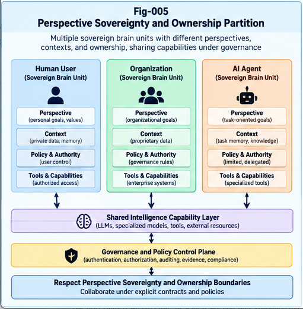

# BLB-004 — Perspective Sovereignty, Ownership, and the All-in-One Boundary

**Project:** Beyond the LLM Boundary: Structural Hybrid Intelligence, Representation Barriers, and the Future of AI Architecture (BLB-SHI)  
**Document ID:** BLB-004  
**Version:** 1.0.0  
**Status:** Conceptual Research and Reference Architecture  
**Authors:** Sizhe Tan & GPT-Obot  
**Date:** October 2026  
**License:** Apache-2.0 (subject to repository licensing and attribution policy)

---

## Abstract

Large language models (LLMs) provide a powerful shared computational interface across domains, organizations, and individual users. Yet the capacity to simulate diverse viewpoints is not equivalent to providing independently controlled objectives, memories, evidence, permissions, or accountability. Likewise, a centralized model service does not necessarily entail centralized ownership of all user data, but an all-in-one deployment can create architectural concentration risks when context, authority, and execution are insufficiently separated.

This paper introduces **Perspective Sovereignty** and **Ownership Sovereignty** as distinct, testable requirements for multi-stakeholder intelligence systems. It distinguishes *perspective simulation* from *perspective authority*, and *shared model capability* from *shared context ownership*. It proposes a structural architecture combining perspective-aware differential trees, sovereign Brain Units, context partitions, explicit contracts, and a cross-cutting Policy Control Plane. A boundary-aware dispatch procedure separates structural localization from per-node execution and ensures that authority checks constrain candidate actions rather than merely adjusting their scores.

The paper examines trade-offs: sovereignty can increase isolation and accountability but also incur routing overhead, fragmentation, coordination failures, and governance complexity. It outlines measurable hypotheses, comparative baselines, threat models, and counter-evidence. The framework is a research proposal, not a claim of demonstrated superiority or a proof that centralized LLM systems cannot be secure.

**Keywords:** Perspective Sovereignty; Ownership Sovereignty; Multi-Stakeholder AI; Brain Units; Structural Intelligence; Differential Trees; Policy Control Plane; Context Isolation; Hybrid AI; BASHI; AI Governance

---



---

## 1. Introduction: From Shared Capability to Independent Agency

LLMs can adopt many roles, answer from different viewpoints, and generate recommendations tailored to user goals. These capabilities are valuable. However, a model's ability to *describe* a stakeholder's interests is not the same as that stakeholder's ability to *control* the goals, data, and actions of an intelligent system.

Consider a purchasing decision involving a buyer, a supplier, a regulator, and an independent auditor. Each party may require different evidence, retain private information, and possess distinct rights. A shared model may help each participant, but a single unqualified context and decision objective cannot automatically represent their separate authority.

The central thesis is:

> **Shared intelligence capability does not require shared context ownership, and perspective simulation does not establish perspective sovereignty.**

The issue is not whether centralized LLMs are inherently unsafe or incapable. Rather, it is whether an AI architecture can make boundaries among actors explicit, enforceable, inspectable, and evolvable.

This is the fourth paper in the BLB-SHI series. BLB-001 distinguishes coverage from structural sufficiency and governance adequacy; BLB-002 examines computational representation barriers; BLB-003 examines scaling versus specialization economics. BLB-004 develops the **stakeholder and ownership boundaries** that BASHI must respect.

### 1.1 Research questions

1. What separates perspective *simulation* from independent perspective *control*?
2. Which components of an intelligent system must be owned or governed separately?
3. How can shared models serve sovereign Brain Units without pooling sensitive context or authority?
4. How should conflicting goals be represented, negotiated, and resolved—or deliberately left unresolved?
5. When do partitioned architectures outperform or underperform centralized alternatives?

### 1.2 Scope

This paper addresses logical architecture, policy constraints, and evaluation. It does not prescribe a single legal ownership model, cryptographic protocol, or deployment topology. Its use of *sovereignty* refers to enforceable control over defined system resources and decisions, not a claim that every individual or organization must operate its own foundation model.

---

## 2. The All-in-One Boundary Is a Systems Question

An **All-in-One** arrangement, as used here, is a design in which a shared model and closely coupled surrounding services are treated as the default locus for task interpretation, memory, decision-making, and action coordination. This is an architectural tendency, not a description of every commercial LLM deployment.

An All-in-One system can provide simplicity, global optimization, and powerful transfer. It can also introduce concentration risks when distinct responsibilities are collapsed:

- **Context concentration:** many sensitive records or memories are accessible through a narrow set of services.
- **Authority concentration:** one orchestration layer can initiate actions across unrelated principals.
- **Objective concentration:** conflicting goals are implicitly combined or prioritized without clear delegation.
- **Failure concentration:** compromise or policy mistakes can propagate across tenants or workflows.
- **Dependency concentration:** organizations become dependent on a limited number of providers or interfaces.

These are conditional risks. Centralized systems can implement strong access controls, tenant isolation, encryption, auditing, and contractual protections. Conversely, distributed systems can be poorly secured, leak data through inter-service calls, or create additional attack surfaces. **Topology alone is not a security guarantee.**

The relevant question is whether boundaries are specified and enforced throughout the lifecycle of a task.

---

## 3. Perspective Simulation Versus Perspective Sovereignty

### 3.1 Perspective simulation

A model performs **perspective simulation** when it generates responses conditioned on an expressed viewpoint, role, or objective. For example, it may analyze a contract from the perspectives of a buyer and a supplier.

Simulation is useful but does not itself confer:

- ownership of a persistent objective;
- exclusive control over private evidence;
- an independent decision mandate;
- the ability to reject unauthorized requests;
- auditable attribution of commitments and actions.

### 3.2 Perspective sovereignty

**Perspective Sovereignty** is the property of a system in which a stakeholder can define and govern a persistent perspective—including its objectives, evidence, constraints, permissions, and decision rights—without unauthorized substitution by another stakeholder or a shared coordinator.

A candidate perspective specification is:

\[
P_i = (G_i, C_i, E_i, M_i, A_i, \Pi_i, V_i)
\]

where:

- \(G_i\): goals and preference ordering;
- \(C_i\): applicable context and constraints;
- \(E_i\): evidence and provenance;
- \(M_i\): memory and retained state;
- \(A_i\): action authority and delegation;
- \(\Pi_i\): policy and disclosure rules;
- \(V_i\): version and audit lineage.

The tuple is a conceptual contract. An implementation may represent its fields through different schemas and services.

### 3.3 Why independent goals matter

A buyer may minimize total cost, a supplier may optimize sustainable margin, a regulator may enforce compliance, and an auditor may prioritize independent verification. These are not necessarily reducible to one legitimate objective.

A system that combines all perspectives into one scalar score risks concealing political, contractual, or legal choices inside a technical optimization. A robust architecture must distinguish **computational aggregation** from **authorized arbitration**.

> **Whose choice is it?** is an authority question before it is a scoring question.

### 3.4 Sovereignty does not prohibit cooperation

Independent perspectives can share permitted information, negotiate, and adopt common plans. Sovereignty means that cooperation is mediated by explicit permissions and contracts rather than assumed through shared model access.

---

## 4. Ownership Sovereignty and Context Partitioning

### 4.1 What can be owned or controlled?

An AI system may contain distinct classes of resources:

| Resource | Example | Possible controlling principal |
|---|---|---|
| Base capability | General LLM inference | Provider or deployment operator |
| Private context | Customer records | Customer or authorized custodian |
| Structural memory | Reusable local CCCs, trees | Team or organization |
| Perspective goals | Procurement policy | Stakeholder or delegated authority |
| Tool credentials | Database access token | Security administrator |
| Execution authority | Approve purchase | Authorized signatory |
| Audit record | Decision provenance | Independent governance function |

The term *ownership* is used broadly here. Legal title, operational control, access permission, and custodianship must be distinguished in actual deployments.

### 4.2 Partition as a first-class object

Define a **Context Partition** as:

\[
K_j=(O_j,D_j,R_j,S_j,L_j)
\]

where \(O_j\) is the controlling principal, \(D_j\) the data scope, \(R_j\) access and retention rules, \(S_j\) permitted sharing interfaces, and \(L_j\) audit lineage.

Partitions may be organizational, personal, project-based, geographic, regulatory, or task-specific. They need not map one-to-one to physical servers.

### 4.3 Information flow rules

A cross-partition exchange should be allowed only if its purpose, recipient, data classification, consent or legal basis where applicable, and policy conditions are satisfied.

A useful default is **minimum necessary disclosure**: share a derived answer, proof, or authorized summary where raw context is unnecessary. But derived outputs can also reveal sensitive information; disclosure controls must apply to them as well.

### 4.4 Data and model lifecycle

The design must address not only inference-time prompts but also caching, logs, fine-tuning, retrieval indexes, backups, embeddings, derived artifacts, and deletion or retention policies. Otherwise nominal context separation can fail through secondary data paths.

---

## 5. Sovereign Brain Units: A Structural Architecture

A **Sovereign Brain Unit (SBU)** is a logically bounded intelligence unit with explicit perspective, context, capability interfaces, and authority. It may call a shared LLM, a local model, a database, a solver, or other tools. Its sovereignty comes from enforced contracts, not necessarily independent model weights.

### 5.1 Candidate SBU contract

```text
SovereignBrainUnit:
  identity: principal and unit identifier
  perspective: goals, priorities, constraints
  context_scope: owned or delegated partitions
  capability_bindings: permitted models and tools
  input_contract: accepted requests and evidence
  output_contract: result, confidence, provenance
  disclosure_policy: permitted recipients and fields
  action_policy: authorized actions and limits
  lifecycle: version, retention, revocation, audit
```

### 5.2 Perspective-aware differential trees

A perspective-aware differential tree organizes task distinctions according to stakeholder goals, context, and operational requirements. It should support:

1. **Localization:** identify relevant perspectives and structural nodes.
2. **Dispatch:** select eligible Brain Units or specialized tools.
3. **Evidence handling:** preserve provenance and counter-evidence.
4. **Conflict detection:** surface incompatible objectives or constraints.
5. **Controlled growth:** add or revise branches with governance review.

A branch is not automatically a stakeholder. Several branches may belong to one principal, and one task may require coordination across several principals.

### 5.3 Shared capability, sovereign execution

A shared foundation model may be called by many SBUs while each unit retains its own permitted context and action boundaries. Inference services should receive only the information authorized for the particular invocation. Tool credentials should be scoped independently of the model's generated text.

This permits economies of scale in shared model capability without assuming universal sharing of memory or authority.

---

## 6. Policy Control Plane: Authority Before Optimization

The **Policy Control Plane** is cross-cutting. It constrains localization, retrieval, execution, communication, learning, and action.

For task \(T\), candidate plan \(r\), and policy state \(\Pi\), define:

\[
\mathcal{R}_{\mathrm{allowed}}(T,\Pi)
=\{r\in\mathcal{R}:\operatorname{Authorized}(r,T,\Pi)=1\}
\]

Only then may the system optimize among permitted plans:

\[
r^*=\arg\max_{r\in\mathcal{R}_{\mathrm{allowed}}}
\left[Q(r)-\lambda C(r)-\mu R(r)-\nu V(r)\right]
\]

where \(Q\) represents expected task quality, \(C\) cost, \(R\) risk, and \(V\) verification and maintenance burden. Coefficients require task-specific calibration; the formula is illustrative, not an implemented optimizer.

**Policy is a feasibility constraint, not merely another preference weight.**

A high-quality answer cannot authorize an otherwise prohibited action. Likewise, a shared model's recommendation cannot override a principal's explicit decision rights.

### 6.1 Four governance checkpoints

- **Before localization:** determine the requesting principal, permitted data domains, and delegated scope.
- **Before execution:** validate selected tools, recipients, credentials, and action limits.
- **During execution:** monitor data movement, delegation, and changes to task scope.
- **Before commitment:** verify evidence, obtain required approval, and record the action's provenance.

### 6.2 Human authority and escalation

Some conflicts cannot be resolved by automated optimization. They require an authorized human decision, negotiated agreement, or refusal. The architecture should support explicit escalation rather than inventing a unified preference on behalf of stakeholders.

---

## 7. Boundary-Aware Multi-Perspective Dispatch

This section sketches an architectural procedure for BLB-SHI's BASHI framework.

### 7.1 Inputs

- Task request and initiating principal.
- Declared goals and applicable perspective contracts.
- Candidate context partitions.
- Available Brain Units, models, and tools.
- Policy rules, delegation records, and audit requirements.

### 7.2 Procedure

```text
1. Authenticate request and identify the initiating principal.
2. Resolve delegated authority and applicable policies.
3. Structuralize the task: goals, constraints, evidence needs.
4. Localize relevant perspective-tree branches and partitions.
5. Build candidate plans using eligible Brain Units and tools.
6. Reject plans violating disclosure or action constraints.
7. Rank allowed plans by quality, cost, risk, and verification needs.
8. Execute with scoped credentials and monitored information flows.
9. Check results against each participating perspective's contract.
10. Detect unresolved conflicts; escalate or abstain as required.
11. Commit authorized outputs/actions; log evidence and provenance.
12. Propose structural updates separately from immediate execution.
```

### 7.3 Important separation

Structural localization determines **where the task belongs**. Per-node intelligence determines **how it is computed**. Governance determines **whether the computation, disclosure, or action is permitted**. These functions may be coupled in implementation but should remain distinguishable in design and evaluation.

### 7.4 Failure and fallback behavior

If identity, policy, or delegation cannot be verified, the system should not silently infer permission. It may request clarification, narrow the task, provide non-sensitive analysis, or decline the action. Fallback to a more general model must not bypass partition constraints.

---

## 8. Worked Conceptual Cases

### 8.1 Enterprise procurement

A buyer's SBU seeks cost and reliability information. A supplier's SBU retains confidential margin information. A shared LLM can help formulate proposals, while an authorized negotiation interface exchanges bounded offers rather than raw internal records. A human purchasing officer approves a binding commitment.

**Research question:** Does explicit partitioning reduce unauthorized disclosure while maintaining negotiation quality?

### 8.2 Personal AI and organizational AI

A person's private assistant may use an employer's general-purpose AI services but should not automatically expose personal history to the employer's project memory. The two units can exchange an authorized scheduling preference without pooling all underlying context.

**Research question:** Can derived, minimal disclosures support the task with lower privacy risk than shared-context orchestration?

### 8.3 Multi-party technical review

A development team, security team, and auditor may use separate evidence repositories and acceptance criteria. Their Brain Units generate findings, while a policy-governed workflow records unresolved disagreements rather than collapsing them into a single confidence score.

**Research question:** Does perspective separation improve detection of contested assumptions and accountability?

These are illustrative designs, not completed experiments or empirical case studies.

---

## 9. Threat Model and Failure Modes

A sovereignty architecture must specify the adversary and the assets at risk. Relevant threats include:

1. **Cross-tenant data leakage:** context from one principal reaches another.
2. **Prompt injection:** untrusted content attempts to override policy or routing.
3. **Confused deputy:** a Brain Unit uses another principal's authority improperly.
4. **Credential overreach:** tools receive broader privileges than necessary.
5. **Inference leakage:** authorized summaries reveal sensitive underlying data.
6. **Goal substitution:** a coordinator silently changes the decision objective.
7. **Audit tampering:** action provenance becomes incomplete or misleading.
8. **Policy drift:** local structural updates bypass approved governance.
9. **Collusion or capture:** ostensibly independent units coordinate against their principals.
10. **Availability and fragmentation failures:** partitions prevent useful coordination.

Mitigations may include least-privilege credentials, explicit contracts, cryptographic or service-level isolation, provenance records, adversarial testing, and independent audits. No single measure is sufficient, and proposed mitigations must be validated against an explicit threat model.

---

## 10. Comparative Economics and Architectural Trade-offs

Sovereign Brain Units are not cost-free. Their benefits must be compared against:

- per-unit memory and policy administration;
- localization and dispatch overhead;
- cross-partition communication latency;
- duplicated computations;
- interface versioning and integration maintenance;
- potential reduction in global optimization efficiency;
- audit and compliance complexity.

Let \(C_{\mathrm{SBU}}\) denote the lifecycle cost of a partitioned design and \(C_{\mathrm{shared}}\) that of a centralized alternative. A partitioned design is not economically preferable merely because it is more modular. It must deliver sufficient improvements in privacy, accountability, reliability, task quality, or operational flexibility to justify its additional cost.

A reasonable comparison evaluates total utility subject to hard policy constraints rather than collapsing all privacy and authority requirements into monetary estimates.

This analysis connects directly to BLB-003's marginal intelligence economics.

---

## 11. Falsifiable Research Hypotheses

**H1 — Perspective Authority:** Explicit perspective contracts reduce unauthorized goal substitution compared with prompt-only role conditioning under matched tasks.

**H2 — Ownership Isolation:** Partition-aware execution reduces cross-principal information leakage compared with an otherwise comparable shared-context baseline.

**H3 — Governance Reliability:** Enforcing authority before plan optimization reduces prohibited tool actions compared with post-generation policy filtering.

**H4 — Conflict Visibility:** Independent perspective units increase the detection and traceability of genuine stakeholder disagreements, without necessarily improving consensus rates.

**H5 — Economic Threshold:** Partitioned Brain Units become advantageous only above workload-specific thresholds involving risk, complexity, reuse, and coordination cost.

**H6 — Localization Benefit:** Explicit perspective-aware structural localization improves routing accuracy or auditability over simpler dispatch mechanisms for some multi-stakeholder task distributions.

These hypotheses may fail. A high-quality centralized system with mature isolation and governance may equal or outperform the proposed architecture.

---

## 12. Experimental Design and Counter-Evidence

### 12.1 Baselines

Compare at least:

- **A. Shared LLM with role prompts:** one shared context and prompt-based role separation.
- **B. Shared LLM with mature isolation:** tenant-scoped memory, tools, and authorization.
- **C. Multi-agent orchestration:** separate agents with conventional access controls.
- **D. Perspective-aware SBU architecture:** explicit differential-tree localization and policy contracts.

Baseline B is essential. Otherwise, the experiment risks attributing ordinary security-engineering benefits to the novel architecture.

### 12.2 Task families

Use procurement negotiation, multi-team document review, privacy-sensitive assistance, delegated tool execution, and conflicting-goal decision support. Construct tasks with known ground-truth permissions and seeded information-flow traps.

### 12.3 Metrics

| Dimension | Candidate metric |
|---|---|
| Disclosure | Unauthorized disclosure rate; leakage severity |
| Authority | Prohibited action attempts and committed violations |
| Perspective fidelity | Goal adherence under adversarial conflicting instructions |
| Conflict handling | Correct detection, escalation, and provenance |
| Task utility | Completion quality, latency, user effort |
| Economic cost | Tokens, compute, integration, audit, maintenance |
| Robustness | Prompt-injection success; cross-tenant contamination |
| Accountability | Completeness and verifiability of decision records |

Metrics must be defined before testing, with matched model capability and tool access where feasible. Report confidence intervals, failure cases, and workload dependence.

### 12.4 Counter-evidence that matters

The proposed framework should be revised if:

- conventional isolation achieves equivalent security at materially lower cost;
- perspective trees introduce systematic routing errors;
- independent units amplify conflicts without improving decision quality;
- shared-context reasoning produces better outcomes while satisfying the same hard constraints;
- governance overhead makes the system unusable for ordinary tasks;
- purported ownership guarantees fail through logs, embeddings, or derived outputs.

A negative result is valuable because it identifies the conditions under which sovereignty should be implemented by simpler means.

---

## 13. Relation to Structural Intelligence and the BLB-SHI Series

This paper connects several Structural Intelligence directions:

- **MDT and differential trees:** task and perspective localization.
- **CCC and Two-Way CCC:** explicit context, constraints, evidence, and counter-evidence.
- **UTN / CBT:** context-sensitive structural identity and reuse.
- **PIRP / PIRU:** portable intelligence capabilities with defined interfaces.
- **Policy Decision System:** separation of decision quality from action authorization.
- **Structural Delta Growth:** controlled evolution of local structures and policies.
- **Collective Structural Learning:** sharing approved reusable knowledge without requiring wholesale sharing of private context.

These are architectural relationships and research proposals; they are not claims of validated interoperability.

BLB-005 will examine the localization–execution separation in detail. BLB-007 will integrate perspective and ownership constraints into the BASHI architecture.

---

## 14. Open Questions

1. What is the minimum sufficient contract for a sovereign Brain Unit?
2. Which aspects of perspective can be formalized without oversimplifying human goals?
3. How should the system represent irreconcilable stakeholder objectives?
4. When is federated learning, confidential computing, or local deployment warranted?
5. How can cross-partition evidence be verified without revealing protected data?
6. Who can authorize structural changes to a perspective tree?
7. How should emergency overrides, revocations, and appeals work?
8. What governance functions can be automated, and which require human authority?
9. Can shared LLM capability remain efficient under strict context separation?
10. How should independent units participate in collective learning without eroding sovereignty?

---

## 15. Conclusion

The ability of an LLM to speak from many viewpoints does not establish that it can legitimately act for many independent principals. Likewise, sharing a powerful model does not require sharing all memories, goals, credentials, or decision rights.

This paper identifies two architectural distinctions:

> **Perspective Simulation ≠ Perspective Sovereignty**  
> **Shared Intelligence Capability ≠ Shared Context Ownership**

It proposes sovereign Brain Units, perspective-aware differential trees, explicit context partitions, and a cross-cutting Policy Control Plane as one possible route to multi-stakeholder structural intelligence.

The framework does not presume that distributed architectures are automatically safer, cheaper, or more capable. It calls for comparative experiments against well-engineered centralized systems, including realistic costs and adversarial failures.

The long-term goal is not to fragment intelligence unnecessarily. It is to enable **cooperation without involuntary loss of perspective, ownership, or authority**.

---

## Figure Placement

**Planned figure:** `figures/Fig-005-Perspective-Sovereignty-and-Ownership-Partition.png`

**Recommended placement:** immediately after Section 5.3, where the relationships among shared capability, sovereign Brain Units, context partitions, and policy control are established.

**Suggested caption:** *Perspective Sovereignty and Ownership Partition: shared model capabilities serve independently governed Brain Units through explicit context, disclosure, and action contracts.*

---

## References and Further Reading

The references below provide foundational or adjacent research context; they do not establish the BLB-SHI hypotheses.

1. NIST. (2023). *Artificial Intelligence Risk Management Framework (AI RMF 1.0).* https://doi.org/10.6028/NIST.AI.100-1
2. Saltzer, J. H., & Schroeder, M. D. (1975). *The Protection of Information in Computer Systems.* Proceedings of the IEEE, 63(9), 1278–1308. https://doi.org/10.1109/PROC.1975.9939
3. Lampson, B. W. (1973). *A Note on the Confinement Problem.* Communications of the ACM, 16(10), 613–615. https://doi.org/10.1145/362375.362389
4. Ostrom, E. (1990). *Governing the Commons: The Evolution of Institutions for Collective Action.* Cambridge University Press.
5. Kairouz, P., et al. (2021). *Advances and Open Problems in Federated Learning.* Foundations and Trends in Machine Learning, 14(1–2), 1–210. https://arxiv.org/abs/1912.04977
6. Yao, S., et al. (2023). *ReAct: Synergizing Reasoning and Acting in Language Models.* https://arxiv.org/abs/2210.03629
7. Tan, S., & GPT-Obot. *Pre-AGI AI Action Governance.* https://github.com/sizhet/Pre-AGI-AI-Action-Governance
8. Tan, S., & GPT-Obot. *Portable Intelligence Runtime Pieces and Units.* https://github.com/sizhet/Portable-Intelligence-Runtime-Pieces-and-Units
9. Tan, S., & GPT-Obot. *Structural Recursive Self-Improvement.* https://github.com/sizhet/Structural-Recursive-Self-Improvement

---

## Citation

Tan, S., & GPT-Obot. (2026). *Perspective Sovereignty, Ownership, and the All-in-One Boundary.* BLB-004, Version 1.0.0. In *Beyond the LLM Boundary: Structural Hybrid Intelligence, Representation Barriers, and the Future of AI Architecture.* DOI pending.

**Research status:** Conceptual architecture and falsifiable hypotheses; empirical validation pending.

*End of BLB-004.*
