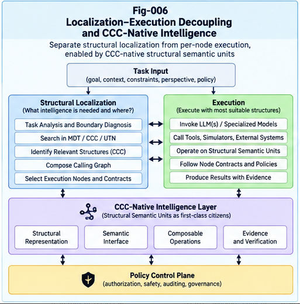

# BLB-005 — Decoupling Structural Localization from Per-Node Intelligence

**Project:** Beyond the LLM Boundary: Structural Hybrid Intelligence, Representation Barriers, and the Future of AI Architecture (BLB-SHI)  
**Document ID:** BLB-005  
**Version:** 1.0.0  
**Status:** Conceptual architecture and proposed skeleton algorithm; empirical validation pending  
**Authors:** Sizhe Tan & GPT-Obot  
**Date:** October 2026  
**License:** Apache-2.0 (repository-level license governs)

---

## Abstract

General-purpose language models have made a common interface to heterogeneous tasks possible. Yet identifying the right knowledge, perspective, computational representation, or execution capability is a different problem from performing the computation itself. This paper proposes **Localization–Execution Decoupling (LED)** as a structural design principle for hybrid intelligence systems: separate the task of locating relevant structural contexts and eligible computational units from the task of executing task-specific intelligence, while retaining explicit contracts and feedback between the two.

The proposed architecture combines task structuralization, perspective-aware differential localization, Context–Concept–Constraint (CCC) matching, Metric Differential Trees (MDT), Universal Token Node (UTN) identities, two-phase candidate search, and heterogeneous per-node execution by LLMs, graph algorithms, SQL engines, solvers, visual models, and portable intelligence units. A policy control plane constrains both routing and execution. Evidence, counter-evidence, provenance, and structural deltas support verification and controlled improvement.

The contribution is not the claim that routing, tool use, or modular execution are new. It is a proposed **separation of structural localization from execution capability**, with typed handoff contracts, perspective and ownership boundaries, explicit uncertainty handling, and a path to localized structural growth. We specify an execution skeleton, selection objective, failure cases, evaluation design, and falsifiable hypotheses. No benchmark or implementation result is claimed.

**Keywords:** Structural Intelligence, Localization–Execution Decoupling, Per-Node Intelligence, MDT, CCC, UTN, Two-Phase Search, Brain Units, Hybrid AI, BASHI, Policy Control Plane, Structural Delta Growth

---



---

## 1. Introduction: Finding Intelligence Is Not Performing Intelligence

A modern AI request often combines multiple questions:

1. **Where** is the relevant knowledge or context?
2. **Whose** goal, evidence, and authority govern the request?
3. **What** representation is native to the required operations?
4. **Which** computational mechanism should execute them?
5. **How** should results be verified, integrated, and authorized?

An all-in-one language-model interaction can obscure these distinctions by presenting a single conversational surface. The surface may be valuable; the hidden coupling may not be optimal for reliability, efficiency, maintainability, or governance.

For example, a user may ask whether a planned software change violates a deployment policy. The request requires localization of the affected service and dependency graph, retrieval of the applicable policy version, selection of graph and rule-evaluation procedures, and an authorized decision. A language model may explain the outcome, but it need not perform every step internally.

**Central proposition:**

> Structural localization and per-node intelligence are distinct architectural responsibilities. They may cooperate tightly, but neither should be assumed to require the same model, representation, memory, or authority domain.

This paper develops that proposition within the BLB-SHI research program. BLB-001 introduced the distinction between intelligence coverage and structural sufficiency; BLB-002 considered representation barriers; BLB-003 examined the economics of specialization; BLB-004 examined perspective sovereignty and ownership. BLB-005 translates those foundations into a proposed executable architectural boundary.

## 2. Definitions and Scope

### 2.1 Structural localization

**Structural localization** is the process of identifying the relevant structural neighborhood for a task: its context, goals, perspectives, constraints, candidate data, tools, and executable intelligence units. It may return multiple candidates, uncertainty estimates, and unresolved dependencies rather than one winning node.

Localization is not synonymous with document retrieval. It can locate:

- A specific version of a concept or CCC;
- A branch of an MDT differential hierarchy;
- A Calling Graph region and its affected dependencies;
- A principal's authorized private memory partition;
- A solver, database engine, or LLM specialist;
- A reusable PIRP/PIRU package and its runtime contract.

### 2.2 Per-node intelligence

**Per-node intelligence** is the task-specific capability executed at a localized node or within a localized structural scope. A node may provide language reasoning, deterministic computation, planning, retrieval, verification, or a composed subworkflow. The term *node* is logical: a node can map to a local process, external service, model, tool, or human review step.

### 2.3 Decoupling is not isolation

LED requires an explicit interface, not a prohibition on interaction. Localization may use an LLM; execution may request further localization; a specialist may discover a missing dependency. The architectural distinction concerns **separable responsibilities, replaceable implementations, and auditable handoffs**.

### 2.4 Three forms of coupling

| Coupling | Example | Potential cost |
|---|---|---|
| Representational | All tasks forced into long prompt text | Loss of native structure or conversion overhead |
| Computational | The same model selects and executes every task | Inefficient specialization and opaque failures |
| Administrative | One runtime implicitly holds every context and permission | Ownership ambiguity and excess privilege |

These are potential costs, not universal defects. Small workloads may favor an integrated system.

## 3. Design Principles

**P1 — Separate the question from its execution.** A task description is not an execution plan.

**P2 — Preserve native representations.** Use graph, relational, mathematical, spatial, or policy structures when their operational properties matter.

**P3 — Localize before expensive computation when useful.** Routing is worthwhile only if its benefit exceeds its latency, complexity, and error costs.

**P4 — Make perspective explicit.** The relevant node depends on whose goal, evidence, and decision authority apply.

**P5 — Enforce authorization throughout.** Policy gates candidate discovery, context access, execution, and output release; it is not merely a final scoring penalty.

**P6 — Preserve uncertainty and counter-evidence.** Localization should expose alternatives and unresolved assumptions rather than silently collapsing uncertainty.

**P7 — Permit controlled structural growth.** Validated failures and successful compositions can propose local structural deltas, subject to versioning and approval.

**P8 — Retain an economical bypass.** Direct LLM execution is a legitimate route when specialized localization adds no value.

## 4. Reference Architecture

The proposed architecture contains six logical planes.

### 4.1 Task and perspective plane

Transforms a request into a **Task Structural Profile (TSP)** containing task intent, expected output, quality constraints, context references, principal identity, perspective goal, permitted operations, and applicable time/version scope.

### 4.2 Structural localization plane

Searches across MDT branches, CCC structures, UTN identities, Calling Graphs, capability catalogs, and authorized context partitions. It emits a set of candidate scopes and execution units, not necessarily a single winner.

### 4.3 Per-node execution plane

Invokes suitable capabilities: LLM/HLM, graph engine, SQL, numerical optimizer, formal verifier, vision model, policy engine, or a PIRU. Multi-node tasks form an explicit dependency DAG or Calling Graph.

### 4.4 Evidence and verification plane

Checks typed outputs, consistency, source provenance, task-specific correctness, uncertainty, and counter-evidence. A language explanation is not a substitute for a required deterministic or formal check.

### 4.5 Policy control plane

Applies ownership, access control, purpose limitation, execution authority, retention rules, and audit obligations across every other plane. Authorization is evaluated before context exposure and before side effects.

### 4.6 Structural growth plane

Records failures, useful new routing distinctions, reusable execution patterns, and proposed CCC or MDT changes. A proposal does not become trusted routing state without a defined conformance and approval process.

### 4.7 Logical flow

```text
Task + Principal + Perspective + Constraints
                 |
                 v
       Task Structural Profile
                 |
          [Policy precheck]
                 |
                 v
     Structural Localization Plane
     MDT / CCC / UTN / CG / Catalog
                 |
        Candidate scopes + confidence
                 |
                 v
       Planner / Capability Selector
                 |
        [Policy and contract gate]
                 |
                 v
       Per-Node Hybrid Execution
     LLM | Graph | SQL | Solver | PIRU
                 |
                 v
       Verification + Counter-Evidence
                 |
       [Release / action policy gate]
                 |
                 v
          Result + Audit Record
                 |
                 v
        Proposed Structural Delta
          [Review / Conformance]
```

**Figure placement:** Insert `../figures/Fig-006-Localization-Execution-Decoupling-and-CCC-Native-Intelligence.png` after this subsection. The shared figure should depict LED and its future CCC-native interface without implying that BLB-006 mechanisms are already implemented.

## 5. Structural Localization Mechanisms

### 5.1 MDT as differential search space

A Metric Differential Tree organizes candidate distinctions by relevant metrics or structural differences. A task can progressively select branches without comparing every candidate in full detail. The branching policy must remain revisable when evidence contradicts a prior localization.

### 5.2 CCC as a context-sensitive matching contract

A CCC is treated here as a structured semantic object carrying a concept, context, constraints, and optionally evidence, policy, and version metadata. Its exact schema is implementation-dependent. CCC matching can identify compatible nodes and reject context-incompatible candidates.

### 5.3 UTN as stable structural identity

A UTN can provide a stable identity for a structural node independent of the natural-language phrase used to find it. Identity, provenance, and version should be separated: an identifier alone does not establish that content is current or authorized.

### 5.4 Calling Graph as execution and dependency map

A Calling Graph represents executable dependencies, data flows, or delegated actions. Localization may return a subgraph rather than a single node. Cycle management, retries, timeouts, and side-effect boundaries belong in the execution contract.

### 5.5 Two-phase search

**Phase 1 — inexpensive candidate discovery:** structural keys, differential-tree traversal, embedding retrieval, capability metadata, and policy-safe filters.

**Phase 2 — focused evaluation:** richer CCC matching, context-specific scoring, feasibility checks, cost estimates, evidence review, and final selection.

Two-phase search is a design option rather than a universal requirement. Its efficiency depends on candidate-set reduction, miss rate, and evaluation cost.

### 5.6 Candidate set, not premature winner-take-all

Localization returns a bounded set of candidates with explanations and uncertainty. A single winner may be selected later, or a composition may be required. If no candidate meets a minimum confidence or authorization threshold, the system must clarify, escalate, or decline rather than invent a route.

## 6. Contracts Between Localization and Execution

A contract is the central mechanism that makes decoupling practical.

### 6.1 Task Structural Profile (TSP)

A conceptual TSP may include:

```yaml
task_id: task-001
principal_ref: principal-pseudonym
perspective_goal: assess-deployment-risk
context_refs: [service-A, policy-v3]
required_operations: [dependency-analysis, policy-check]
quality_requirements:
  verification: required
  deadline_ms: 5000
authority:
  permitted_actions: [read, recommend]
  prohibited_actions: [deploy]
uncertainty:
  unresolved: [upstream-dependency-version]
```

The example is illustrative; it is not a finalized protocol or implementation.

### 6.2 Localization result

A localization result should identify candidate node IDs, matched structural evidence, perspective scope, estimated suitability, required data access, and unresolved assumptions. Confidence values must be calibrated before they are treated as probabilities.

### 6.3 Execution capability contract

A capability declares input and output schemas, supported operations, expected quality envelope, latency/cost profile, version, permissions, side effects, failure codes, and evidence requirements. These claims should be tested through conformance checks rather than accepted from self-description alone.

### 6.4 Result and provenance contract

The result records which nodes ran, which versions and data sources were used, verification status, remaining uncertainty, policy decisions, and permitted downstream uses. Private content should not be copied into global logs by default.

### 6.5 Specifications before runtime

Following the broader SI program's *Specifications/Contracts First* principle, the runtime must reject incompatible or unauthorized interfaces rather than improvise around contract violations. Graceful fallback may be allowed only within a pre-authorized envelope.

## 7. Selection and Composition Objective

Let \(\mathcal{R}(T)\) denote the candidate execution plans for task \(T\), including a direct-LLM baseline and hybrid plans. Define the authorized subset:

\[
\mathcal{R}_{\mathrm{allowed}}(T,P)
=\{r\in\mathcal{R}(T):\operatorname{PolicyValid}(r,P)=1\}.
\]

For a plan \(r\), define expected quality \(Q(r)\), total execution and localization cost \(C(r)\), operational risk \(R(r)\), and verification/integration burden \(V(r)\). One illustrative objective is:

\[
r^* = \underset{r\in\mathcal{R}_{\mathrm{allowed}}(T,P)}{\arg\max}
\left[Q(r)-\lambda C(r)-\mu R(r)-\nu V(r)\right].
\]

This objective is not directly deployable without calibrated, comparable measures and appropriate hard quality constraints. A practical planner may instead use constrained multi-objective optimization, lexicographic safety priorities, or Pareto filtering.

A hybrid plan is justified only if its expected improvement exceeds routing, translation, integration, verification, and maintenance costs. A small task with adequate LLM reliability may legitimately bypass specialized routing.

## 8. BASHI-LED Skeleton Algorithm

```text
Algorithm BASHI-LED(T, Principal, PolicyState):
  1. TSP <- STRUCTURALIZE(T, Principal)
  2. REQUIRE POLICY_PRECHECK(TSP, PolicyState)
  3. Boundaries <- PROFILE_BOUNDARIES(TSP)
  4. Candidates <- LOCALIZE_PHASE_1(TSP, authorized_index)
  5. Candidates <- REFINE_PHASE_2(Candidates, TSP, Boundaries)
  6. Include DIRECT_LLM_BASELINE when policy-permitted
  7. Plans <- BUILD_FEASIBLE_COMPOSITIONS(Candidates, TSP)
  8. Plans <- FILTER_BY_CONTRACT_AND_POLICY(Plans)
  9. if Plans is empty:
       return CLARIFY_OR_ESCALATE_WITH_REASON
 10. Plan <- SELECT_BY_QUALITY_COST_RISK(Plans)
 11. Results <- EXECUTE_WITH_GATES(Plan)
 12. Verified <- VERIFY_EVIDENCE_AND_COUNTER_EVIDENCE(Results)
 13. if Verified fails:
       RETRY_OR_RELOCALIZE_WITH_BOUNDED_BUDGET
       otherwise ESCALATE_OR_FAIL_CLOSED
 14. REQUIRE OUTPUT_AND_ACTION_POLICY_GATE(Verified)
 15. RECORD_MINIMAL_PROVENANCE_AND_AUDIT(Verified)
 16. PROPOSE_STRUCTURAL_DELTA_IF_JUSTIFIED(Verified)
 17. return AUTHORIZED_RESULT(Verified)
```

### 8.1 Runtime invariants

- No unauthorized context may enter localization or execution.
- No execution side effect occurs without explicit authorization.
- Every node receives only the data needed by its contract.
- Verification requirements cannot be silently downgraded.
- Failed localization is observable and recoverable within bounded budgets.
- A proposed structural update cannot silently modify trusted policy.

### 8.2 Feedback loops

Execution may expose missing context or contradict a localization assumption. The system should return a typed **re-localization request** with evidence and bounded retry limits. This supports Two-Way CCC: constraints and expectations flow toward execution, while counter-evidence and observed differences flow back toward structural localization.

## 9. Worked Architectural Cases

### 9.1 Software change impact analysis

**Task:** Determine whether a proposed API change breaks downstream services.

Localization identifies the relevant service subgraph, schema versions, and deployment policy. Per-node graph analysis enumerates affected paths; an LLM may summarize findings; a rule checker validates compatibility requirements. The system recommends a change but does not deploy without authorization.

**Expected comparative advantage:** Native graph traversal and explicit dependency provenance may reduce errors and token-heavy reasoning. This is a hypothesis, not a measured result.

### 9.2 Enterprise financial reporting

**Task:** Explain a revenue discrepancy.

Localization finds the correct reporting period, data owner, table lineage, and accounting perspective. SQL performs aggregates; a deterministic reconciliation routine checks totals; an LLM drafts the explanation. Policy limits access to authorized rows and prohibits cross-client context mixing.

**Potential failure:** Schema mismatch or stale data lineage can invalidate the answer despite correct SQL execution.

### 9.3 Formal constraint checking

**Task:** Determine whether a scheduling proposal satisfies a set of hard constraints.

Localization identifies the current constraints and solver capability. The solver returns a feasible assignment or proof of infeasibility under its formal model. An LLM explains assumptions and tradeoffs. The result must not be described as verified if the solver's model omitted a requirement.

### 9.4 Multi-perspective organizational decision

**Task:** Compare a procurement option under finance, operations, compliance, and supplier perspectives.

Localization resolves separate perspective-specific evidence and policies. Dedicated Brain Units produce independently attributable evaluations. An aggregation stage reports conflicts without erasing stakeholder ownership. Only an authorized principal can approve the action.

## 10. Failure Modes and Counter-Evidence

LED introduces real architectural risks.

| Failure | Mechanism | Mitigation / test |
|---|---|---|
| Wrong node selected | Poor localization features | Recall@k, counterfactual routing tests |
| Relevant node omitted | Over-aggressive pruning | Candidate recall, fallback search |
| Context fragmentation | Cross-node information loss | Contract completeness, end-to-end consistency |
| Routing tax dominates | Excessive orchestration | Compare with direct LLM baseline |
| Permission leakage | Index or logging crosses ownership | Access tests, partition isolation |
| Capability drift | Tool behavior changes after registration | Version pinning, conformance retesting |
| Error amplification | Chained nodes propagate mistakes | Stage-wise validation and bounded retries |
| Policy conflict | Multiple authorities disagree | Explicit precedence and escalation |
| Growth contamination | Unverified deltas enter routing | Review gates, provenance, rollback |

A rigorous research program must publish unfavorable cases as well as successes. In particular, improved LLMs or better tool-calling agents may erase the benefits of explicit structural localization for some task families.

## 11. Evaluation and Falsifiable Hypotheses

### 11.1 Baselines

Compare at least:

- **A:** Direct general-purpose LLM;
- **B:** LLM with conventional tool calling and retrieval;
- **C:** Standard semantic/vector router with specialist tools;
- **D:** BASHI-LED with explicit structural localization, contracts, and policy gates.

All systems should use matched task data, comparable model access, defined budgets, and equivalent security requirements. Report quality and full lifecycle cost, not inference tokens alone.

### 11.2 Metrics

**Localization:** Recall@k, precision@k, candidate reduction, calibration, time-to-locate, and false exclusion rate.

**Execution:** Task correctness, latency, cost, error propagation, deterministic validation pass rate, and recovery success.

**Governance:** Unauthorized access attempts blocked, unauthorized actions prevented, policy consistency, and audit completeness.

**Growth:** Time to incorporate a new capability, regression rate, rollback success, and maintenance burden.

**System:** End-to-end utility, throughput, total cost of ownership, reliability under distribution shift, and operator effort.

### 11.3 Hypotheses

**H1 — Localization benefit:** For some heterogeneous workloads, structural localization improves end-to-end quality/cost relative to direct LLM execution.

**H2 — Native execution benefit:** Native graph, SQL, and solver operations outperform token-centric execution on selected task scales and verification requirements.

**H3 — Decoupling benefit:** Independent localization and execution interfaces reduce the cost of adding or replacing specialist capabilities.

**H4 — Perspective fidelity:** Explicit perspective routing reduces cross-stakeholder context or objective confusion compared with shared-context baselines.

**H5 — Governance benefit:** Contract- and policy-gated execution reduces unauthorized actions without unacceptable usability degradation.

**H6 — Structural growth benefit:** Verified local routing updates improve adaptation speed with fewer regressions than selected global-update alternatives.

Each hypothesis may be falsified by experiments showing no benefit, unacceptable overhead, or worse outcomes after matched controls.

### 11.4 Experimental discipline

Pre-register task sets and success thresholds where feasible. Use held-out and adversarial cases, report uncertainty intervals, perform ablations for MDT/CCC/UTN components, and distinguish localization gains from gains attributable simply to stronger specialists. Include failure case narratives and counter-evidence.

## 12. Relationship to Existing AI Architectures

LED builds on established ideas rather than replacing their history.

- **Retrieval-Augmented Generation (RAG)** separates retrieval from generation, but typically focuses on knowledge access rather than the full space of structural localization, ownership, execution, and policy.
- **Mixture-of-Experts (MoE)** separates expert selection and computation within model architectures; LED proposes broader, potentially cross-system and cross-owner coordination.
- **Tool-using agents** route work to external software; LED emphasizes explicit structural identities, perspective-aware context, typed contracts, and controlled structural growth.
- **Service-oriented and workflow architectures** already separate routing and execution in software engineering; LED's proposed contribution lies in applying structured, evidence-aware localization and intelligence-specific boundaries to adaptive hybrid systems.

The distinctive BLB-SHI proposition is a particular combination of **structural localization + heterogeneous per-node intelligence + perspective/ownership contracts + verification + governed growth**. Novelty and benefit remain subject to careful related-work comparison and empirical testing.

## 13. Relationship to CCC-Native Intelligence

BLB-006 investigates the possibility of making CCC-like structures first-class semantic units within language-model interfaces. LED does not require CCC-native model modifications. It can begin with external structured objects and ordinary model/tool APIs.

A CCC-native implementation might later improve matching, context compression, or compositional reasoning. It could also increase training and integration complexity. The architecture must therefore keep the CCC interface replaceable and benchmarkable rather than assuming native integration will always win.

## 14. Progressive Engineering Path

**Stage 0 — Contracts first:** Define TSP, capability descriptors, authority boundaries, result provenance, and failure semantics.

**Stage 1 — Small reference workload:** Implement a direct LLM baseline plus one graph or SQL specialist; record routing and verification costs.

**Stage 2 — Explicit structural localization:** Add a small MDT/CCC catalog, stable node IDs, and two-phase candidate search.

**Stage 3 — Policy and perspective partitions:** Introduce separate principals, context partitions, authorization tests, and auditable decision paths.

**Stage 4 — Governed local growth:** Propose and review routing deltas based on evidence and failures; measure regressions.

**Stage 5 — Portable and collective capabilities:** Explore PIRP/PIRU relay and cross-system interoperability under ownership-preserving contracts.

These are prospective engineering stages, not claims of completed implementation.

## 15. Open Questions

1. What structural information most improves localization beyond vector similarity?
2. When does two-phase search outperform a strong one-stage router?
3. How should node identities, context versions, and provenance interact?
4. How should confidence and counter-evidence be represented across heterogeneous nodes?
5. Which contracts can be standardized without constraining specialized capabilities?
6. What is the smallest useful policy control plane for a multi-owner workflow?
7. How should execution feedback trigger re-localization without creating unbounded loops?
8. When does a direct LLM bypass dominate structural orchestration?
9. How can the architecture learn routing distinctions from sparse differential evidence?
10. Can CCC-native model interfaces reduce the costs of cross-representation handoffs?

## 16. Conclusion

The distinction between **finding the appropriate intelligence** and **performing the intelligence** is a useful architectural lens for systems that combine language models with specialized representations, tools, and independent actors.

Localization–Execution Decoupling does not assert that every system needs a separate router, or that LLMs are incapable of specialized tasks. It proposes that localization and execution should be **independently specifiable, testable, replaceable, and governable** when task heterogeneity and system scale justify that separation.

The resulting BASHI-LED architecture retains the broad interface and reasoning strengths of LLMs while allowing graph engines, databases, solvers, specialized models, and portable intelligence units to perform tasks in their native structures. Perspective, ownership, and policy constraints determine not only which result is preferred but which computation is permissible.

> **Localize the intelligence needed; execute with the structure best suited to the task; verify with appropriate evidence; govern every consequential action.**

This principle provides the architectural bridge from the boundary analyses in BLB-001–004 to CCC-native intelligence in BLB-006 and the integrated BASHI design in BLB-007.

---

## References and Related Research

1. Vaswani, A., et al. (2017). *Attention Is All You Need.* https://arxiv.org/abs/1706.03762
2. Lewis, P., et al. (2020). *Retrieval-Augmented Generation for Knowledge-Intensive NLP Tasks.* https://arxiv.org/abs/2005.11401
3. Fedus, W., Zoph, B., & Shazeer, N. (2022). *Switch Transformers: Scaling to Trillion Parameter Models with Simple and Efficient Sparsity.* https://arxiv.org/abs/2101.03961
4. Yao, S., et al. (2023). *ReAct: Synergizing Reasoning and Acting in Language Models.* https://arxiv.org/abs/2210.03629
5. Schick, T., et al. (2023). *Toolformer: Language Models Can Teach Themselves to Use Tools.* https://arxiv.org/abs/2302.04761
6. Tan, S., & GPT-Obot. *Metric Differential Tree, UTN, and Context-Bound Token Intelligence.* https://github.com/sizhet/Metric-Differential-Tree-UTN-and-Context-Bound-Token-Intelligence
7. Tan, S., & GPT-Obot. *Portable Intelligence Runtime Pieces and Units.* https://github.com/sizhet/Portable-Intelligence-Runtime-Pieces-and-Units
8. Tan, S., & GPT-Obot. *Principle Intelligence and Open Structural Learning.* https://github.com/sizhet/Principle-Intelligence-and-Open-Structural-Learning
9. Tan, S., & GPT-Obot. *Structural Recursive Self-Improvement.* https://github.com/sizhet/Structural-Recursive-Self-Improvement

**Related series:** BLB-001 through BLB-008, *Beyond the LLM Boundary: Structural Hybrid Intelligence, Representation Barriers, and the Future of AI Architecture*.

## Suggested Citation

Tan, S., & GPT-Obot. (2026). *Decoupling Structural Localization from Per-Node Intelligence* (BLB-005, v1.0.0). In *Beyond the LLM Boundary: Structural Hybrid Intelligence, Representation Barriers, and the Future of AI Architecture*. DOI pending.

---

*End of BLB-005.*
