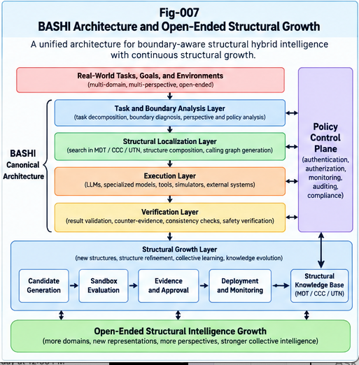

# BLB-008 — From LLM Boundaries to Open-Ended Structural Intelligence Growth

**Series:** Beyond the LLM Boundary: Structural Hybrid Intelligence, Representation Barriers, and the Future of AI Architecture (BLB-SHI)  
**Authors:** Sizhe Tan & GPT-Obot  
**Version:** v1.0.0  
**Date:** October 2026  
**Status:** Conceptual research and falsifiable architecture proposal  
**Repository path:** `docs/BLB-008-From-LLM-Boundaries-to-Open-Ended-Structural-Intelligence-Growth.md`

---

## Abstract

The boundaries of large language models (LLMs) need not be interpreted solely as deficits to be eliminated by increasing model scale. They can also be treated as signals indicating where intelligence should be reorganized: into specialized representations, independent perspectives, locally governed computational units, verifiable interfaces, and reusable structural knowledge. This article develops an **Open-Ended Structural Intelligence Growth** (OESIG) framework that extends Boundary-Aware Structural Hybrid Intelligence (BASHI) from task-level routing to controlled architectural evolution. A boundary observation may lead to a new node, an alternative execution representation, a revised Context–Concept–Constraint (CCC) structure, a portable intelligence component, a new verification contract, or a new ownership partition. However, not every observed failure warrants structural growth, and not every apparent improvement deserves promotion. We therefore distinguish *candidate generation*, *evaluation*, *authorization*, *deployment*, and *post-deployment monitoring*. The proposed framework incorporates counter-evidence, rollback, versioned contracts, multi-perspective governance, and economic break-even tests. We articulate a measurable growth objective, an executable conceptual lifecycle, failure modes, and experiments that could falsify the approach. The central thesis is conditional: **open-ended growth becomes a credible engineering objective only when the creation of new structure is coupled to evidence, governance, and the ability to reverse mistakes.**

**Keywords:** structural intelligence; open-ended growth; LLM boundaries; BASHI; structural recursive self-improvement; CCC; MDT; localization–execution decoupling; collective structural learning; governance; counter-evidence; portable intelligence

---



*Figure 7. Boundary-aware task execution feeds a governed structural-growth cycle; evidence, authorization, monitoring, and retirement constrain promotion.*

---

## 1. Introduction: A Boundary Can Be a Growth Signal

A general-purpose LLM can often describe a task without being the most reliable or economical mechanism for performing it. This distinction motivated the earlier papers in this series:

- **BLB-001** examined language-accessible intelligence and the limits of universal coverage.
- **BLB-002** characterized computational representation barriers.
- **BLB-003** compared scaling economics with structural specialization.
- **BLB-004** examined perspective sovereignty, ownership, and the all-in-one boundary.
- **BLB-005** separated structural localization from per-node intelligence execution.
- **BLB-006** proposed CCC-native structural semantic units.
- **BLB-007** integrated these mechanisms into the BASHI reference architecture.

The final question is not merely *how should an existing system execute a task?* It is:

> **How can an intelligent system discover, evaluate, incorporate, and govern new forms of intelligence without requiring every advance to be absorbed into one monolithic model?**

We propose that a system may grow by expanding its repertoire of representations, interfaces, nodes, policies, perspectives, and evidence mechanisms. This is not a claim that unconstrained autonomous self-modification is safe or desirable. On the contrary, the architecture is designed around **bounded authority and evidence-gated change**.

### 1.1 Three distinct notions of improvement

The following improvements must not be conflated:

1. **Answer improvement:** a better result on a particular task.
2. **Capability improvement:** a reusable increase in performance over a defined task distribution.
3. **Structural growth:** an evaluated change to the system's persistent organization, such as a new route, node, representation, contract, or ownership boundary.

A better answer does not necessarily demonstrate a new capability. A capability improvement does not necessarily justify adding permanent structural complexity. Structural growth is warranted only when the expected future benefit exceeds the associated integration, maintenance, verification, and governance costs.

### 1.2 Scope and epistemic status

This paper presents an architectural research program, not empirical proof that BASHI or OESIG outperforms modern LLM systems. The proposed mechanisms overlap with established work on modular systems, mixture-of-experts, tool use, program synthesis, continual learning, and multi-agent coordination. The distinctive hypothesis is their **joint organization around explicit boundary profiles, structural localization, governed promotion, and reversible growth**. Novelty and efficacy must be established through controlled comparison.

---

## 2. From Fixed Capability to Structural Growth

### 2.1 A fixed-system view

A conventional deployment is often modeled as a relatively stable function:

$$
 y = F_{\theta}(x,c),
$$

where \(x\) is the task, \(c\) the supplied context, and \(\theta\) the deployed model parameters. External tools and retrieval can augment this function, but their integration may still be managed as a fixed set of components.

### 2.2 A structurally evolving system

We instead model the deployed intelligence system at time \(t\) as:

$$
 \mathcal{S}_t = (N_t,E_t,R_t,C_t,P_t,O_t,V_t),
$$

where:

- \(N_t\): executable intelligence nodes, including LLMs, solvers, graph engines, and human-controlled units;
- \(E_t\): routing, dependency, and calling-graph edges;
- \(R_t\): representations and conversion interfaces;
- \(C_t\): CCC objects, context structures, and versioned knowledge;
- \(P_t\): policies, permissions, and authority constraints;
- \(O_t\): ownership and perspective partitions;
- \(V_t\): verification methods, evidence stores, and audit records.

A proposed structural delta \(\Delta_t\) produces a candidate:

$$
 \mathcal{S}_{t+1}^{\mathrm{candidate}} = operatorname{Apply}(\mathcal{S}_t,\Delta_t).
$$

The candidate becomes an authorized deployed system **only after** passing the applicable evaluation and promotion gates. The notation does not imply automatic self-authorization.

### 2.3 What can grow?

| Growth object | Example | Principal risk | Required evidence |
|---|---|---|---|
| Representation | Add a graph-native plan rather than prose-only traversal | Translation or semantic mismatch | Equivalence and correctness tests |
| Localization | Add a new MDT branch or routing predicate | Misrouting and fragmentation | Routing accuracy and regret |
| Execution node | Introduce a specialized solver | Tool defects or unexpected side effects | Sandboxed tests and contracts |
| CCC unit | Extract a reusable context-bound concept | Overgeneralization or stale context | Counterexamples and provenance |
| Verification | Add an independent checker | False confidence or checker correlation | Calibration and adversarial tests |
| Perspective | Add a sovereign Brain Unit | Authority confusion | Ownership and delegation review |
| Policy | Narrow or revise a capability permission | Unsafe expansion or operational deadlock | Governance approval and regression tests |
| Collective interface | Publish a portable PIRP/PIRU component | Supply-chain and trust risk | Provenance, signature, compatibility |

Growth can also consist of **removing** an obsolete branch, merging redundant units, narrowing permissions, or retiring an unreliable component. Open-ended growth is not synonymous with monotonically increasing system size.

---

## 3. Boundary-Driven Structural Growth

### 3.1 Boundary profiles as observations

Following BLB-007, a task–system interaction can be characterized by a six-axis boundary profile:

$$
 \mathbf{b}(T,\mathcal{S}) = (b_R,b_C,b_L,b_P,b_O,b_G),
$$

representing **representation**, **computation**, **learning**, **perspective**, **ownership**, and **governance** limitations. The components are diagnostic scores or structured assessments, not assumed to be calibrated or mutually independent.

A boundary observation may originate from failed execution, high cost, unacceptable latency, weak evidence, a rejected authorization, conflicting perspectives, or a user-identified mismatch.

### 3.2 Boundary-to-delta mapping

| Observed boundary | Candidate structural response | Non-growth alternative |
|---|---|---|
| Representation | Native graph/SQL/math interface; CCC schema | Better prompt or parser |
| Computation | Specialized node, batching, caching | More efficient existing tool call |
| Learning | New versioned CCC or routing branch | Retrieval or context refresh |
| Perspective | Separate perspective state and evaluation | Explicit perspective prompt for non-sovereign tasks |
| Ownership | Local Brain Unit and delegated contract | Existing access-control mechanism |
| Governance | Policy checkpoint or independent verification | Correct an existing misconfiguration |

**A boundary is a hypothesis generator, not a mandate to restructure.** An observed error may be a one-off, a data-quality defect, or a problem solvable by an existing component.

### 3.3 The boundary-to-growth cycle

1. **Observe:** record the task, route, outcome, costs, evidence, and applicable policy.
2. **Diagnose:** determine whether the failure is reproducible and identify plausible boundary axes.
3. **Localize:** identify the node, interface, CCC, or partition most likely responsible.
4. **Propose:** generate multiple alternatives, including a no-change baseline.
5. **Sandbox:** test candidates in an isolated environment with controlled inputs.
6. **Verify:** evaluate quality, cost, robustness, and counter-evidence.
7. **Authorize:** obtain approval from the relevant ownership and policy authority.
8. **Promote:** deploy gradually with versioned contracts and rollback capability.
9. **Monitor:** detect regressions, drift, externalities, and unanticipated failures.
10. **Retire or revise:** preserve the ability to reverse the change.

This cycle is intentionally asymmetric: proposing a delta may be inexpensive, while promoting one can require substantial evidence.

---

## 4. The Open-Ended Growth Space

### 4.1 Growth beyond a single frontier

Structural growth is often imagined as adding increasingly sophisticated reasoning nodes at the frontier of a search tree. In practice, useful changes can arise at many levels:

- **Upstream:** better task decomposition and context identification;
- **Lateral:** an alternative representation or execution route;
- **Downstream:** stronger verification, monitoring, or reporting;
- **Cross-cutting:** ownership partitions, policy constraints, and versioned contracts;
- **Collective:** externally contributed, locally validated portable components;
- **Subtractive:** pruning, consolidation, or revocation.

Thus the growth space is better described as a partially ordered, multi-dimensional design space than a single ladder of model capability.

### 4.2 Growth operators

Let \(\mathcal{D}\) be a family of admissible structural-delta operators:

$$
 \mathcal{D}=\{operatorname{Add},operatorname{Replace},operatorname{Split},
 operatorname{Merge},operatorname{Refine},operatorname{Restrict},
 operatorname{Retire},operatorname{Delegate}\}.
$$

Examples include splitting a general node into domain-specific routes, replacing a prose-only computation with an SQL query, refining a CCC's applicability conditions, or delegating a task to an independently owned unit.

Every operator must declare its target objects, preconditions, expected effects, rollback strategy, and authorization requirements. This is a proposed contract discipline, not a claim that all changes can be made perfectly reversible.

### 4.3 Novelty without novelty worship

A new component should not be rewarded merely for being new. Structural diversity is useful when it yields measurable robustness, specialized capability, reduced cost, improved governance, or reduced dependency on a single failure mode. Redundant components can also improve resilience, but only if their errors and dependencies are sufficiently independent.

---

## 5. Growth Economics and the Complexity Tax

BLB-003 argued that structural specialization must compete against improved generalist models and simpler tool integrations. Open-ended growth introduces an additional cost: the accumulation of persistent architectural complexity.

### 5.1 Expected net value

For candidate delta \(\Delta\), define a research objective:

$$
 \begin{aligned}
 operatorname{ENV}(\Delta) ={}& \mathbb{E}_{T\sim D}
 [U(T,\mathcal{S}\oplus\Delta)-U(T,\mathcal{S})]\\
 &-C_{\mathrm{integration}}(\Delta)
 -C_{\mathrm{maintenance}}(\Delta)\\
 &-C_{\mathrm{verification}}(\Delta)
 -C_{\mathrm{governance}}(\Delta)
 -C_{\mathrm{complexity}}(\Delta).
 \end{aligned}
$$

Here \(D\) is an explicitly stated workload distribution, and \(U\) may combine task quality, latency, compute expenditure, reliability, and other stakeholder-defined outcomes. These quantities need not share a natural unit; empirical studies must state their normalization and weighting.

A candidate is **eligible for consideration** only if it meets all hard policy and safety constraints. Positive expected net value alone never grants authority to deploy.

### 5.2 Growth break-even

Suppose a new structural route incurs fixed lifecycle cost \(F\), reduces per-task cost by \(s\), and is expected to serve \(n\) comparable tasks. Ignoring discounting and uncertainty, a necessary economic condition is:

$$
 ns > F.
$$

This simplified threshold becomes less favorable when routing errors, distribution shift, verification overhead, and coordination costs are included. Conversely, improvements in reliability or governance may justify a route even without lower compute cost, provided their value is explicitly measured.

### 5.3 The structural debt problem

Uncontrolled growth can generate **structural debt**: redundant branches, obsolete CCCs, incompatible contracts, ambiguous ownership, and increasingly expensive regression tests. A credible growth framework must budget for pruning and consolidation, not just expansion.

---

## 6. CCC, MDT, and Per-Node Intelligence as Growth Substrates

### 6.1 MDT: where growth is localized

A Metric Differential Tree (MDT) can represent distinctions that guide structural search and routing. When repeated errors cluster in a region of task space, a candidate MDT refinement may be warranted. Such a refinement must be tested against both the targeted cases and adjacent regions to detect overfitting or fragmentation.

### 6.2 CCC: what is learned structurally

A CCC may encode a reusable concept with explicit context, constraints, evidence, policy, and version. Its lifecycle is not simply *extract and store*. A defensible lifecycle is:

$$
 \text{Candidate CCC}
 \rightarrow \text{Context validation}
 \rightarrow \text{Counter-evidence testing}
 \rightarrow \text{Authorized promotion}
 \rightarrow \text{Monitoring / revision}.
$$

Two-Way CCC mechanisms should preserve the distinction between supporting evidence and disconfirming evidence. A rule that succeeds on a narrow dataset should not be promoted as universal without applicability constraints.

### 6.3 UTN: stable identity across change

Unique Token/Node identification mechanisms, as proposed in the broader SI research program, can support versioned identity, references, provenance, and migration. Stable identifiers do not by themselves guarantee semantic stability; contract versions and compatibility tests remain necessary.

### 6.4 Per-node intelligence: growth without universal replacement

A node may use an LLM, HLM, graph algorithm, SQL engine, optimizer, theorem prover, simulator, human review, or other executor. A new node should be introduced because its measurable task-level comparative advantage justifies the integration burden, not because every node must become more sophisticated.

### 6.5 CCC-native integration

BLB-006 proposed progressive integration from CCC references to CCC-conditioned embeddings and structural operations. In OESIG, these are **possible growth routes**, not assumed achievements. They require tests of semantic fidelity, context leakage, update behavior, and efficiency against ordinary retrieval and tool-calling baselines.

---

## 7. PIRP/PIRU and Collective Structural Learning

### 7.1 Portable intelligence as a growth channel

A **Portable Intelligence Runtime Piece (PIRP)** can be treated as a transferable capability description or artifact, while a **Portable Intelligence Runtime Unit (PIRU)** represents a more formally specified, contract-bound unit. These are research constructs from the related SI program, not established interoperability standards.

Their proposed role is to make useful structure transferable without requiring all participants to share the same model weights, memory, or ownership domain.

### 7.2 Import is not trust

A portable component received from another system should enter a quarantine or candidate state. Import validation should include:

- source provenance and integrity checks;
- interface and schema compatibility;
- licensing and redistribution permissions;
- privacy and ownership constraints;
- sandboxed functional and adversarial tests;
- local workload relevance;
- explicit local promotion authority.

A component's prior success elsewhere does not establish its suitability for a different perspective, policy regime, or task distribution.

### 7.3 Collective learning without compulsory centralization

A federation of sovereign Brain Units could exchange validated CCCs, routing patterns, verification methods, or PIRP/PIRU artifacts while retaining separate context stores and decision rights. This is a design possibility, not a guarantee of privacy: even shared metadata, gradients, summaries, and evaluation traces can reveal sensitive information.

The governing principle is:

> **Share useful intelligence structures where authorized; do not infer that sharing capability requires surrendering ownership or decision authority.**

### 7.4 A federation-level learning loop

1. A participant detects a recurring structural boundary.
2. It develops and evaluates a candidate improvement locally.
3. It publishes a permitted, versioned, provenance-bearing artifact.
4. Other participants independently test the artifact against their own constraints.
5. Each participant accepts, modifies, rejects, or retires the artifact under its own governance.
6. Aggregated non-sensitive evidence may inform subsequent versions.

The loop is collective only to the extent that participants actually exchange and validate reusable structures.

---

## 8. Policy Control Plane: Growth Must Not Self-Authorize

### 8.1 The authority boundary

A system that can propose a new action route must not automatically gain permission to execute that route. Similarly, a system that can draft a new policy must not be able to approve that policy merely by assigning it a favorable score.

**Policy is not simply another soft optimization penalty.** Authorization is a feasibility constraint:

$$
 \Delta \in \mathcal{A}_{\mathrm{authorized}}(owner,scope,time,policy).
$$

The authorized set can change only through a legitimate governance process.

### 8.2 Three control checkpoints

- **Before execution:** validate task scope, data access, ownership, and permitted actions.
- **During execution:** enforce least privilege, bounded delegation, rate and resource limits, and logging where appropriate.
- **After execution:** validate outputs, review evidence, detect incidents, and decide whether a proposed structural delta can be promoted.

### 8.3 Promotion classes

A useful engineering distinction is:

| Change class | Example | Indicative approval |
|---|---|---|
| Low impact | Cache policy within existing permission scope | Automated tests under delegated authority |
| Medium impact | New internal routing branch | Owner-approved staged deployment |
| High impact | New external tool or data-sharing interface | Security/privacy and owner review |
| Critical impact | Expanded autonomous action authority | Explicit accountable human or institutional authorization |

These are illustrative classes; real thresholds depend on domain, law, safety requirements, and deployment context.

### 8.4 The rollback principle

Rollback capability should be designed before deployment. For some changes, particularly external actions or disclosures, rollback is impossible. Such changes require stronger ex ante authorization and containment, rather than a false assurance of reversibility.

---

## 9. OESIG Canonical Lifecycle and Skeleton Algorithm

### 9.1 Inputs and outputs

**Inputs:** task traces, outcome metrics, boundary observations, current architecture graph, evidence, owner policies, resource budget, and candidate growth operators.

**Outputs:** a rejected or deferred candidate; a versioned, authorized structural delta; or a monitored rollback/retirement decision.

### 9.2 Conceptual pseudocode

```text
OESIG_GROWTH_CYCLE(system S, observations X, authority A, budget B):

  1. incidents <- normalize_and_provenance_check(X)
  2. patterns  <- detect_reproducible_boundary_patterns(incidents)

  3. for each pattern p:
       diagnosis <- localize_boundary(p, S)
       candidates <- propose_deltas(diagnosis, S)
       candidates <- candidates UNION {NO_CHANGE, IMPROVE_EXISTING_ROUTE}

       for each candidate d:
         if not proposal_is_within_design_scope(d, A):
             record_rejection(d, "scope violation")
             continue

         contract <- specify_preconditions_interfaces_and_rollback(d)
         evidence <- sandbox_evaluate(
             S, d, contract,
             quality_cost_latency_robustness_security_tests,
             counter_evidence_and_regression_tests,
             budget=B
         )

         if not evidence_meets_promotion_threshold(evidence):
             record_rejection_or_deferral(d, evidence)
             continue

         if not explicit_authorization(A, d, contract, evidence):
             record_rejection_or_deferral(d, "not authorized")
             continue

         release <- staged_deploy_with_monitoring(S, d, contract)
         if release.violates_guardrails:
             rollback_where_possible(release)
             escalate_irreversible_effects(release)
         else:
             record_versioned_promotion(release, evidence)

  4. periodically_evaluate_pruning_merging_and_retirement(S)
  5. return audit_log_and_current_authorized_version(S)
```

The algorithm is a **reference skeleton**, not runnable implementation or evidence that any particular policy or detector is adequate.

### 9.3 Contracts first

Each proposed delta should specify:

- **Identity:** stable ID, author or origin, version, dependency graph;
- **Applicability:** task region, context preconditions, known exclusions;
- **Interfaces:** inputs, outputs, data formats, error semantics;
- **Evidence:** test datasets, evaluation protocol, counterexamples;
- **Authority:** owner, permissible scope, approval path;
- **Resources:** cost, latency, compute, storage, and maintenance budgets;
- **Lifecycle:** staging, monitoring, rollback, expiry, and retirement conditions.

This approach is consistent with the broader SI research principle of **Specifications/Contracts First**.

---


*Figure 7. Boundary-aware task execution feeds a governed structural-growth cycle; evidence, authorization, monitoring, and retirement constrain promotion.*

---

## 10. Worked Scenarios

### 10.1 Calling-graph intelligence

**Observation:** A prose-oriented coding agent repeatedly misses cross-module dependencies in a large codebase.

**Candidate:** Add a graph-native dependency analyzer and a calling-graph-aware localization branch.

**Evaluation:** Compare against a strong LLM with repository search and existing code tools. Measure dependency recall, false positives, end-to-end repair correctness, latency, and maintenance cost. Require tests on unseen repositories.

**Growth decision:** Promote only if the graph-native route delivers a reproducible net benefit and remains within repository access permissions.

### 10.2 Financial SQL analytics

**Observation:** The LLM can explain aggregation requests but makes arithmetic or join errors when reasoning over tables as prose.

**Candidate:** Introduce a typed SQL route with schema validation, read-only access, and query-result verification.

**Evaluation:** Compare against LLM-generated SQL with ordinary tool use; the new structural route must demonstrate incremental value beyond the tool baseline. Test schema changes, injection attempts, ambiguous metric definitions, and query costs.

**Growth decision:** Add a route only if it improves correctness or governance enough to justify additional complexity.

### 10.3 Perspective-sovereign planning

**Observation:** Multiple organizations share a general reasoning model but cannot share confidential objectives or grant each other unrestricted action authority.

**Candidate:** Establish separate Brain Units with scoped delegation and a minimal shared coordination protocol.

**Evaluation:** Test task completion, information leakage, conflicting objectives, delegation correctness, and auditability. Compare against centralized architectures with robust access control rather than a deliberately weak baseline.

**Growth decision:** Partition only when organizational requirements and measured outcomes support the cost.

### 10.4 Counter-evidence-driven CCC refinement

**Observation:** A reusable CCC performs well in one context but repeatedly fails in another.

**Candidate:** Split its applicability domain, attach explicit exceptions, or retire the CCC.

**Evaluation:** Use held-out counterexamples, neighboring contexts, and regression suites. Measure whether the refinement reduces errors without destroying useful generalization.

**Growth decision:** Prefer a narrower, better-calibrated rule to an unjustified universal claim.

---

## 11. Research Hypotheses and Falsification

The following are proposed hypotheses, not established findings.

### H1 — Boundary-driven growth efficiency

For heterogeneous workloads with recurrent representation mismatches, boundary-driven structural changes can outperform continued use of a fixed generalist route on quality-adjusted lifecycle cost.

**Falsifier:** A strong fixed LLM+tools baseline matches or exceeds quality at equal or lower full cost, including integration and maintenance.

### H2 — Localization reduces growth waste

Localizing recurrent failures to specific task regions reduces unnecessary architectural changes relative to indiscriminate component addition.

**Falsifier:** Localization produces no significant improvement in promoted-delta utility or increases missed opportunities.

### H3 — Evidence-gated promotion improves reliability

Counter-evidence and regression gates reduce harmful promotions relative to simple success-rate-based promotion.

**Falsifier:** Gates add substantial overhead without reducing deployment regressions or consequential errors.

### H4 — Structural pruning is necessary for sustained efficiency

Periodic retirement and consolidation reduce long-term structural debt while retaining useful capability.

**Falsifier:** Pruning consistently removes valuable capabilities or creates greater cost than it saves.

### H5 — Federated structural learning can preserve useful sovereignty

Contract-bound exchange of portable structures can deliver some collective-learning benefits without pooling all underlying context or decision authority.

**Falsifier:** Benefits disappear under realistic privacy and permission constraints, or leakage remains unacceptable.

### H6 — Growth diversity has conditional value

A diverse set of specialized representations improves resilience and task performance when the components have complementary strengths and sufficiently independent failure modes.

**Falsifier:** Diversity increases coordination and error propagation without measurable reliability or coverage gains.

### H7 — CCC-native growth is not universally beneficial

CCC-native mechanisms improve efficiency only in task families with repeated, reusable structural semantics and manageable versioning costs.

**Falsifier of the conditional hypothesis:** No identifiable task region shows advantage over strong retrieval and structured-tool baselines after full cost accounting.

### H8 — Governance and learning can be jointly designed

Explicit promotion authority and lifecycle contracts reduce unauthorized structural change without making all beneficial adaptation prohibitively slow.

**Falsifier:** Authorized adaptation becomes impractically slow or unsafe changes still bypass the controls.

---

## 12. Experimental Roadmap

### 12.1 Comparison systems

A fair evaluation should include:

- **B0 — Generalist LLM:** strong prompt and context configuration;
- **B1 — LLM + retrieval and tools:** production-quality interfaces and verification;
- **B2 — Fixed modular hybrid:** static routing with specialized executors;
- **B3 — Adaptive hybrid without evidence-gated growth:** comparable components with simplified promotion;
- **B4 — Full proposed OESIG/BASHI:** boundary profiling, localization, versioned contracts, evidence-gated promotion, governance, and pruning.

Control for model quality, tool availability, workload distribution, engineering effort, and compute budget. B4 must not receive privileged tools or more labeled data than the baselines without explicit disclosure.

### 12.2 Benchmark families

1. Codebase dependency and calling-graph analysis.
2. SQL analytics with schema drift and access controls.
3. Mathematical or constraint-based computation with independent checking.
4. Multi-perspective planning with conflicting objectives and data partitions.
5. Continual task streams with recurring patterns and distribution shift.
6. Portable-component import under heterogeneous policy and compatibility conditions.

### 12.3 Metrics

| Dimension | Illustrative metrics |
|---|---|
| Task performance | Correctness, calibrated uncertainty, completion rate |
| Resource use | Tokens, compute, latency, energy where measurable |
| Growth quality | Accepted-delta utility, false promotion rate, missed opportunity rate |
| Routing | Localization precision/recall, route regret, fallback rate |
| Robustness | Out-of-distribution performance, adversarial failures, regression count |
| Structural debt | Node/edge count, maintenance hours, obsolete component ratio |
| Governance | Unauthorized-action rate, audit completeness, policy conflicts |
| Collective exchange | Import success, compatibility failures, privacy leakage |
| Recovery | Time to detect regressions, rollback success, residual damage |

### 12.4 Experimental discipline

Use preregistered hypotheses where practical, held-out task distributions, repeated trials, confidence intervals, ablation studies, and independent review of consequential failures. Report negative results and engineering effort. Distinguish measured efficiency from estimates based solely on token counts.

### 12.5 Suggested phased program

**Phase I — Boundary characterization:** Establish reproducible cases where prose-centric execution is inferior to native representations.

**Phase II — Fixed hybrid baseline:** Demonstrate that localization and specialized execution add value beyond a strong tool-using LLM.

**Phase III — Governed structural adaptation:** Test delta proposal, sandbox evaluation, approval, staged deployment, and rollback.

**Phase IV — Longitudinal growth:** Measure months-long accumulation, pruning, drift, and maintenance cost.

**Phase V — Federated exchange:** Evaluate portable structural artifacts across independent ownership domains.

Progression to later phases should depend on evidence from earlier phases, not on an assumption that all architectural layers are necessary.

---

## 13. Failure Modes and Counter-Evidence

### 13.1 Boundary misdiagnosis

A model error may be attributed to a representation barrier when the actual cause is incomplete data or a poor tool implementation. **Mitigation:** include root-cause alternatives and no-change baselines.

### 13.2 Structural overfitting

A new branch may fit a small collection of incidents but harm nearby tasks. **Mitigation:** held-out tasks, neighboring-context tests, and staged rollout.

### 13.3 Coordination explosion

Adding nodes and interfaces may create latency, failure propagation, and maintenance burdens. **Mitigation:** lifecycle accounting, dependency audits, pruning, and interface simplification.

### 13.4 False verification confidence

Multiple verifiers can share correlated blind spots. **Mitigation:** independent methods, adversarial cases, and calibrated uncertainty rather than majority voting alone.

### 13.5 Authority laundering

A system may present a prohibited action as a sequence of apparently permitted subtasks. **Mitigation:** end-to-end policy checks, delegated scope tracking, and audit of composite actions.

### 13.6 Collective-learning contamination

Imported CCCs or components may be malicious, stale, or incompatible. **Mitigation:** provenance, quarantine, local validation, and explicit trust boundaries.

### 13.7 Irreversible effects

A deployed action may leak information or modify external systems irreversibly. **Mitigation:** stronger pre-action controls; do not rely on rollback as a substitute for authorization.

### 13.8 Generalist progress erases the advantage

Future LLMs may become sufficiently reliable and economical that specialized routes no longer justify their cost. **Mitigation:** continuously rebenchmark and retire redundant specialization. This outcome would count as evidence against specific BASHI deployments, not a reason to redefine success after the fact.

---

## 14. Relationship to Adjacent Research

The OESIG proposal should be evaluated against, and not confused with, several established traditions:

- **Mixture-of-experts and modular neural networks:** specialize computation within learned or designed routing systems. OESIG emphasizes heterogeneous executors, ownership partitions, explicit contracts, and lifecycle governance.
- **Retrieval-augmented generation and tool-using agents:** provide external knowledge and capabilities. OESIG asks when such capabilities should become persistent, versioned, evidence-gated architectural structures.
- **Continual learning:** studies adaptation under changing data distributions and catastrophic forgetting. OESIG includes nonparametric structural changes and governance but does not solve continual-learning challenges by definition.
- **Program synthesis and automated software engineering:** can generate candidate programs or tools. OESIG requires independent validation and authorization before those candidates become trusted components.
- **Evolutionary architecture search and open-ended learning:** explore novel designs and behaviors. OESIG proposes constraints on promotion, ownership, and rollback that may limit unconstrained exploration.
- **Multi-agent systems and federated learning:** distribute computation and authority. OESIG distinguishes transferable structures from the transfer of raw data, model weights, or decision rights.

A rigorous contribution claim requires demonstrating incremental benefits relative to strong representatives of these approaches.

---

## 15. Open Questions

1. What is the smallest reliable representation of a boundary observation that supports useful structural diagnosis?
2. How should a system estimate the expected lifetime value of a candidate delta under uncertain future workloads?
3. When does a new MDT branch improve localization rather than fragment the task space?
4. Which CCC semantics can be made portable without leaking sensitive context?
5. How can independent verifiers be selected to minimize correlated failures?
6. What governance mechanisms permit rapid local adaptation while preventing unauthorized authority expansion?
7. How should sovereign Brain Units resolve conflicting objectives without assuming a single universal utility function?
8. Can structural growth be compressed, distilled, or consolidated without losing its audit trail?
9. How should the system distinguish genuine new capability from benchmark-specific overfitting?
10. What evidence would justify retiring a once-useful specialized node in favor of a stronger generalist model?
11. How can collective-learning participants share negative results and counter-evidence with minimal privacy leakage?
12. Which aspects of this architecture are genuinely necessary, and which can be replaced by simpler established mechanisms?

---

## 16. The BLB-SHI Synthesis

The eight papers form a progression from boundary recognition to governed structural evolution:

| Paper | Primary question | Contribution to the proposed architecture |
|---|---|---|
| BLB-001 | What can language-accessible intelligence cover? | Coverage is not sufficiency |
| BLB-002 | Where do representations differ operationally? | Computational representation barriers |
| BLB-003 | When does specialization pay? | Lifecycle economics and break-even |
| BLB-004 | Whose perspective and ownership apply? | Sovereign authority and partition boundaries |
| BLB-005 | How should work be located and executed? | Localization–execution decoupling |
| BLB-006 | How can structured meaning be reused? | CCC-native semantic-unit interfaces |
| BLB-007 | How do the mechanisms form one system? | BASHI canonical architecture |
| **BLB-008** | **How can the system evolve responsibly?** | **Evidence-gated, reversible structural growth** |

The resulting conceptual loop is:

$$
 \boxed{\text{Observe boundary}}
 \rightarrow \boxed{\text{Localize cause}}
 \rightarrow \boxed{\text{Propose structural delta}}
 \rightarrow \boxed{\text{Test + counter-evidence}}
 \rightarrow \boxed{\text{Authorize}}
 \rightarrow \boxed{\text{Deploy + monitor}}
 \rightarrow \boxed{\text{Revise / retire}}.
$$

The Policy Control Plane spans every stage. At no point does improved predictive capability automatically confer expanded decision authority.

### 16.1 Four non-equivalences

The broader research program can be summarized by four distinctions:

> **Intelligence coverage is not representation sufficiency.**  
> **Representation sufficiency is not computational optimality.**  
> **Computational optimality is not governance adequacy.**  
> **Architectural growth is not evidence of beneficial intelligence growth.**

### 16.2 The open-ended hypothesis

An intelligent system may achieve sustainable improvement not only by increasing the scale of a single model, but by discovering and validating new structures for computation, context, specialization, verification, and cooperation. The hypothesis is plausible, but remains contingent on measurable advantage over simpler alternatives and on credible control of structural debt and authority.

---

## 17. Conclusion

LLM boundaries can be interpreted as opportunities for better representation and coordination rather than solely as deficiencies awaiting larger models. BASHI provides a proposed task-level architecture for diagnosing boundaries, localizing intelligence, selecting heterogeneous executors, and verifying results under explicit policy. OESIG extends that proposal to the system lifecycle: how a new route, CCC, node, ownership partition, or portable intelligence artifact becomes a legitimate part of the architecture.

The decisive distinction is between **generating a structural idea** and **earning the right to deploy it**. A useful growth framework must support both innovation and rejection. It must be able to add new intelligence structures, but also to prune them, expose counter-evidence, respect ownership, and halt when the evidence is insufficient.

The long-term aspiration is not a boundless, self-authorizing machine. It is an **open yet governed intelligence ecosystem** in which representations, capabilities, and perspectives can evolve while their claims remain testable and their actions remain accountable.

> **Open-ended structural intelligence is not unlimited growth. It is the disciplined capacity to discover, verify, govern, and, when necessary, reverse new forms of intelligence.**

---

## 18. References and Related Research

The following sources provide context and comparison points; they should not be read as empirical validation of OESIG.

1. Vaswani, A., et al. (2017). *Attention Is All You Need*. Advances in Neural Information Processing Systems. https://arxiv.org/abs/1706.03762
2. Kaplan, J., et al. (2020). *Scaling Laws for Neural Language Models*. https://arxiv.org/abs/2001.08361
3. Hoffmann, J., et al. (2022). *Training Compute-Optimal Large Language Models*. https://arxiv.org/abs/2203.15556
4. Fedus, W., Zoph, B., & Shazeer, N. (2022). *Switch Transformers: Scaling to Trillion Parameter Models with Simple and Efficient Sparsity*. Journal of Machine Learning Research, 23(120). https://jmlr.org/papers/v23/21-0998.html
5. Lewis, P., et al. (2020). *Retrieval-Augmented Generation for Knowledge-Intensive NLP Tasks*. https://arxiv.org/abs/2005.11401
6. Schick, T., et al. (2023). *Toolformer: Language Models Can Teach Themselves to Use Tools*. https://arxiv.org/abs/2302.04761
7. Yao, S., et al. (2023). *ReAct: Synergizing Reasoning and Acting in Language Models*. ICLR. https://arxiv.org/abs/2210.03629
8. Kirkpatrick, J., et al. (2017). *Overcoming catastrophic forgetting in neural networks*. Proceedings of the National Academy of Sciences, 114(13), 3521–3526. https://doi.org/10.1073/pnas.1611835114
9. Stanley, K. O., & Lehman, J. (2015). *Why Greatness Cannot Be Planned: The Myth of the Objective*. Springer.
10. Stanley, K. O., Lehman, J., & Soros, L. (2017). *Open-Endedness: The Last Grand Challenge You've Never Heard Of*. O'Reilly Artificial Intelligence Conference (position piece; conceptual context).
11. Tan, S., & GPT-Obot. *Structural Recursive Self-Improvement*. Research repository. https://github.com/sizhet/Structural-Recursive-Self-Improvement
12. Tan, S., & GPT-Obot. *Generalized Structural Trigger and Computational Growth Intelligence*. Research repository. https://github.com/sizhet/Generalized-Structural-Trigger-and-Computational-Growth-Intelligence
13. Tan, S., & GPT-Obot. *Portable Intelligence Runtime Pieces and Units*. Research repository. https://github.com/sizhet/Portable-Intelligence-Runtime-Pieces-and-Units
14. Tan, S., & GPT-Obot. *Principle Intelligence and Open Structural Learning*. Research repository. https://github.com/sizhet/Principle-Intelligence-and-Open-Structural-Learning
15. Tan, S., & GPT-Obot. *Metric Differential Tree, UTN, and Context-Bound Token Intelligence*. Research repository. https://github.com/sizhet/Metric-Differential-Tree-UTN-and-Context-Bound-Token-Intelligence
16. Tan, S., & GPT-Obot. *Pre-AGI AI Action Governance*. Research repository. https://github.com/sizhet/Pre-AGI-AI-Action-Governance

---

*BLB-SHI v1.0.0 — Research hypotheses and reference architecture; not a claim of implemented or empirically validated system performance.*
